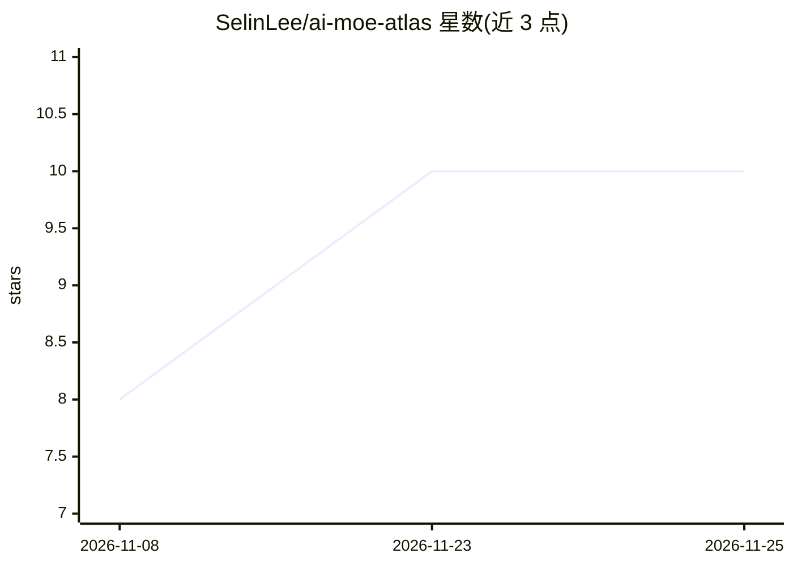

# SelinLee/ai-moe-atlas

⭐ 10 · JavaScript · NOASSERTION · 推送 2026-11-22 · [GitHub](https://github.com/SelinLee/ai-moe-atlas) · [官网](https://selinlee.github.io/ai-moe-atlas/) · 个人维护 · 中文 README

**AI 拟人角色图鉴与素材库：收录出处与二次创作资产**

以百科形式收集 AI 拟人（娘化）角色的图鉴、歌曲、三视图、视频二创与桌宠项目，按六个板块组织，共 58 个角色词条、77 首歌曲、764 条视频记录等。每条素材保留作者署名链、原始投稿链接、文件哈希（SHA-256）核对记录与逐件许可说明；点赞与 Star 数据附观测时刻与历史快照。提供在线图鉴、素材包下载与素材工坊入口，README 以中英日三语呈现。

## 筛选速览

| 维度 | 判定 | 备注 |
|---|---|---|
| AI 角色 | `ai-knowledge` | 知识聚合/清单类 |
| 许可风险 | `none` | NOASSERTION |
| 部署形态 | `None` |  |
| 模型依赖 | — | README 未给出锁定关系 |
| 硬件要求 | — | 无带数字的原话,不猜 |
| 安装摩擦 | `low` | 无编译、无系统依赖或容器化 |
| 成熟度 | — | 结构信号不足 |

## 能力要点

- 58 个 AI 产品拟人角色词条，含作者与原作出处索引
- 逐件文件哈希（SHA-256）核对与署名链记录
- 77 首二创歌曲与 764 条视频条目附点赞观测证据
- 123 个桌宠与交互项目按 GitHub Star 排名收录

## 适用场景

- 查找某个 AI 产品的拟人角色设定及其原始出处
- 二次创作时确认素材的署名要求和使用条件
- 浏览 AI 拟人相关的翻唱、动画与桌宠项目

## 场景标签

`精选清单` · 领域:学习与行业

## 证据(README 行号)

> L5: 收集有出处的 AI 拟人角色、可用素材和社区二创。先选一个分类，或向下看看可爱的角色们。
> L20: **🎨 角色图鉴** · 58 个词条\
> L35: **📚 作者作品与出处** · 96 条来源\

## 星数曲线

2026-11-08 8 → 2026-11-25 10（+2）

---
*卡片 v1 · prompt 1.4 · 生成 2026-11-23 · 置信度 high · 依据 README sha `7ad1a87b8f4d` · [字段定义](../../DATASET.md)*
