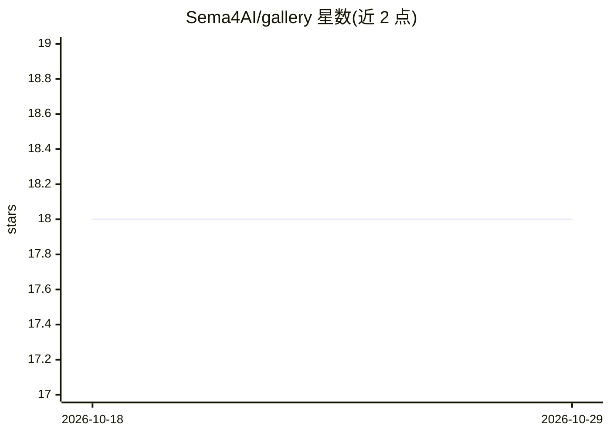

# Sema4AI/gallery

⭐ 18 · Python · Apache-2.0 · 推送 2026-06-10 · [GitHub](https://github.com/Sema4AI/gallery) · [官网](https://sema4.ai) · 组织维护

**Sema4.ai 官方预构建 AI Actions 与 Agents 集合**

Sema4.ai 维护的官方仓库，汇集预构建的 AI Actions 与 Agents。README 仅列出 Agents 与 Actions 两个板块的标题，未展示条目内容、安装步骤或使用说明。从仓库描述可知内容面向使用 Sema4.ai 平台的用户，提供可直接使用的 AI 行为与代理制品；具体清单、依赖与运行方式需查看仓库内目录结构。

## 筛选速览

| 维度 | 判定 | 备注 |
|---|---|---|
| AI 角色 | `ai-ecosystem` | LLM/agent 周边工具 |
| 许可风险 | `permissive` | Apache-2.0 |
| 部署形态 | `None` |  |
| 模型依赖 | — | README 未给出锁定关系 |
| 硬件要求 | — | 无带数字的原话,不猜 |
| 安装摩擦 | `low` | 无编译、无系统依赖或容器化 |
| 成熟度 | — | 结构信号不足 |

## 能力要点

- 官方维护的预构建 Agents 集合
- 官方维护的预构建 AI Actions 集合

## 适用场景

- 查找 Sema4.ai 平台可直接使用的官方 Agent
- 获取官方预构建 AI Action 用于流程自动化

## 场景标签

`工作流自动化` `AI 助手` · 领域:效率与自动化

## 证据(README 行号)

> L1: # Official Sema4.ai Agents and Actions

## 星数曲线

2026-10-18 18 → 2026-10-29 18（+0）

---
*卡片 v1 · prompt 1.4 · 生成 2026-10-29 · 置信度 low · 依据 README sha `2bba1d627bca` · [字段定义](../../DATASET.md)*
