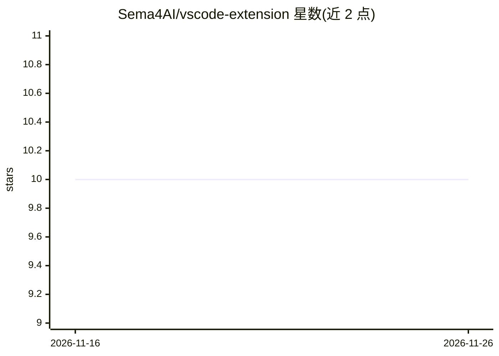

# Sema4AI/vscode-extension

⭐ 10 · Python · Apache-2.0 · 推送 2026-11-25 · [GitHub](https://github.com/Sema4AI/vscode-extension) · [官网](https://sema4.ai/docs/platform/vs-code) · 组织维护

**为开发者在 VS Code 中开发 Python 自动化 Action 的扩展**

Sema4.ai 提供的 VS Code 扩展 SDK，定位为面向 Python 的 AI Action 与自动化任务开发工具，属于 Sema4.ai SDK 体系的一部分。README 内容极为简短，除名称定位外仅包含开发、发布与问题反馈章节的指引链接，以及通过命令面板中的 Submit Issue 报告问题、在 #dev-tools-bugs 频道跟进的流程说明，未给出具体安装命令、功能清单或运行要求。

## 筛选速览

| 维度 | 判定 | 备注 |
|---|---|---|
| AI 角色 | `ai-ecosystem` | LLM/agent 周边工具 |
| 许可风险 | `permissive` | Apache-2.0 |
| 部署形态 | `None` |  |
| 模型依赖 | — | README 未给出锁定关系 |
| 硬件要求 | — | 无带数字的原话,不猜 |
| 安装摩擦 | `low` | 无编译、无系统依赖或容器化 |
| 成熟度 | — | 结构信号不足 |

## 能力要点

- VS Code 扩展形式，面向 Python 自动化任务开发
- 定位为 AI Action 与 Automation 开发工具
- 通过命令面板内置 Submit Issue 上报问题

## 适用场景

- 在 VS Code 中开发 Sema4.ai 的 Python 自动化 Action
- 搭建 AI Action 项目的开发环境

## 场景标签

`工作流自动化` · 领域:效率与自动化

## 证据(README 行号)

> L3: # Sema4.ai VSCode Extension SDK
> L5: Sema4.ai SDK: Visual Studio Code Extension for Automation Tasks development

## 星数曲线

2026-11-16 10 → 2026-11-26 10（+0）

---
*卡片 v1 · prompt 1.4 · 生成 2026-11-20 · 置信度 mid · 依据 README sha `4aa3b52337f2` · [字段定义](../../DATASET.md)*
