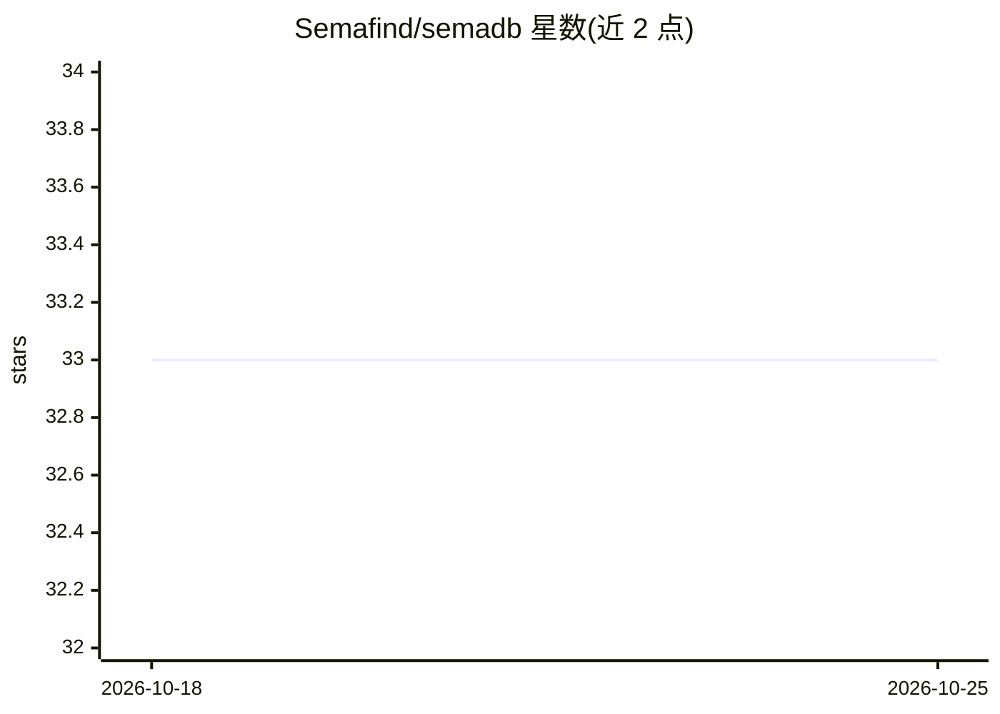

# Semafind/semadb

⭐ 33 · Go · Apache-2.0 · 推送 2026-08-27 · [GitHub](https://github.com/Semafind/semadb) · [官网](https://semadb.com/) · 组织维护

**自托管多索引混合向量数据库/搜索引擎**

SemaDB 是文档型向量数据库与搜索引擎，单一二进制文件部署，通过 JSON RESTful API 操作。支持基于 Vamana/DiskANN 图算法的近似最近邻向量搜索、关键词/文本倒排索引、地理索引、多向量与混合搜索、量化向量以降低内存。支持集群模式、自动分片、多租户与 Prometheus 监控。源自 Semafind 知识管理项目，现为独立项目。运行需安装 Go，或用 Docker/Podman 容器部署。README 说明冷启动磁盘读取可能较慢（建议 SSD），水平扩展仅在启动时同步。

## 筛选速览

| 维度 | 判定 | 备注 |
|---|---|---|
| AI 角色 | `ai-ecosystem` | LLM/agent 周边工具 |
| 许可风险 | `permissive` | Apache-2.0 |
| 部署形态 | `self-host` | docker 或自建部署 |
| 模型依赖 | — | README 未给出锁定关系 |
| 硬件要求 | — | 无带数字的原话,不猜 |
| 安装摩擦 | `low` | 无编译、无系统依赖或容器化 |
| 成熟度 | — | 结构信号不足 |

## 能力要点

- 单一二进制文件，无需额外依赖，JSON RESTful API
- 向量/关键词/地理/多向量混合搜索可在单次查询中组合
- 集群模式、自动分片与多租户支持
- PQ/BQ 量化降低内存占用，含 ann-benchmarks 性能数据

## 适用场景

- 自托管向量检索服务支撑语义搜索应用
- 在同一数据库中组合向量、关键词、地理位置过滤查询
- 多租户场景下为不同用户提供隔离的集合与索引

## 场景标签

`向量数据库` · 领域:知识与检索

## 证据(README 行号)

> L11: SemaDB is a multi-index, multi-vector, document-based vector database / search engine. It is designed to offer a cl
> L21: - **Vector search**: leverage the power of vector search to find similar items and build AI applications. SemaDB us

## 星数曲线

2026-10-18 33 → 2026-10-25 33（+0）

---
*卡片 v1 · prompt 1.4 · 生成 2026-10-25 · 置信度 high · 依据 README sha `1db989446e3f` · [字段定义](../../DATASET.md)*
