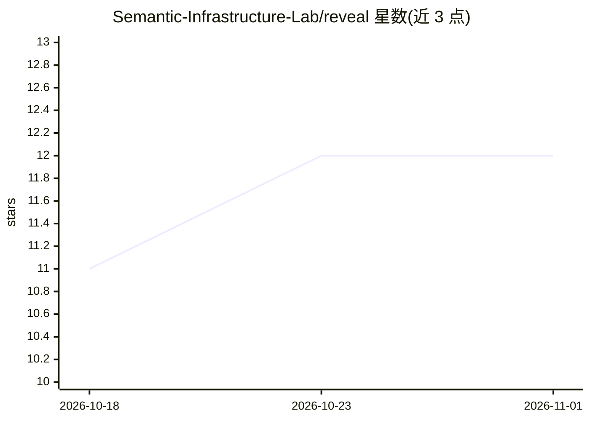

# Semantic-Infrastructure-Lab/reveal

⭐ 12 · Python · MIT · 推送 2026-10-31 · [GitHub](https://github.com/Semantic-Infrastructure-Lab/reveal) · 组织维护

**供 AI agent 与工程师渐进式查看代码库结构的 CLI**

本地优先的语义检查层工具：以单一 CLI 与 URI 适配器（35 个，覆盖 51 种语言/格式）提供渐进式披露——目录先见树、文件先见大纲、指明元素才返回代码，并支持跨文件调用图分析、复杂度检查、PR 变更上下文打包（pack）与 token 预算控制。提供 MCP 服务器（10 个工具）接入 Claude Code、Cursor、Windsurf 等 agent。明确不修改代码、不运行 LLM 推理。pip 安装，git 相关功能需额外 extras。

## 筛选速览

| 维度 | 判定 | 备注 |
|---|---|---|
| AI 角色 | `ai-ecosystem` | LLM/agent 周边工具 |
| 许可风险 | `permissive` | MIT |
| 部署形态 | `desktop` | 安装包/桌面程序 |
| 模型依赖 | — | README 未给出锁定关系 |
| 硬件要求 | — | 无带数字的原话,不猜 |
| 安装摩擦 | `low` | 无编译、无系统依赖或容器化 |
| 成熟度 | — | 结构信号不足 |

## 能力要点

- 35 个 URI 适配器覆盖 51 种语言与文件格式（AST/调用图/DNS/SSL/MySQL 等）
- 渐进式披露：目录→文件→元素逐级下钻，控制 token 消耗
- pack 命令生成带 token 预算的 PR 上下文快照供 AI agent 使用
- 内置 MCP 服务器 reveal-mcp，提供 10 个工具接入 agent

## 适用场景

- 让编程 agent 在读代码前先获得项目结构图，节省 token
- 重构前用调用图分析函数的影响范围
- 在 CI/CD 中对变更文件做质量检查

## 场景标签

 · 领域:开发者工具/代码分析

## 证据(README 行号)

> L3: **Reveal is how AI agents understand codebases without wasting tokens.**
> L69: **Native MCP server (`reveal-mcp`) for AI agent integration:**

## 星数曲线

2026-10-18 11 → 2026-11-01 12（+1）

---
*卡片 v1 · prompt 1.4 · 生成 2026-11-01 · 置信度 high · 依据 README sha `b1bfe2af746b` · [字段定义](../../DATASET.md)*
