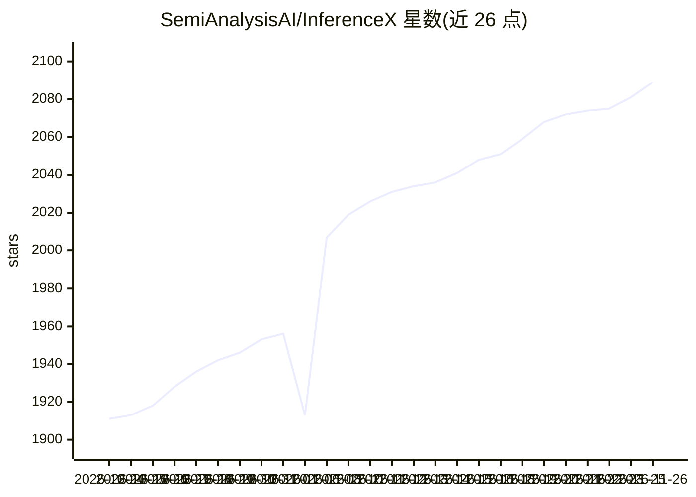

# SemiAnalysisAI/InferenceX

⭐ 2,089 · Python · Apache-2.0 · 推送 2026-11-25 · [GitHub](https://github.com/SemiAnalysisAI/InferenceX) · [官网](https://inferencex.com/) · 组织维护 · 中文 README

**持续基准测试开源推理框架与 GPU 性能的研究平台**

InferenceX（前身为 InferenceMAX）是一个开源推理性能研究平台，对主流开源推理框架在多种 GPU 硬件上进行端到端推理服务、网络通信、算子/内核、硬件微基准等多层基准测试，并通过公开 dashboard 实时发布结果；项目以 Apache 2.0 许可发布，README 未提供安装步骤，官方结果仅以本仓库为准，fork 结果需标注 Unofficial。硬件支持清单覆盖 NVIDIA、AMD 及 TPU 多个 SKU，部分标注 Coming Soon。

## 筛选速览

| 维度 | 判定 | 备注 |
|---|---|---|
| AI 角色 | `ai-ecosystem` | LLM/agent 周边工具 |
| 许可风险 | `permissive` | Apache-2.0 |
| 部署形态 | `None` |  |
| 模型依赖 | local-ok | 支持本地模型 |
| 硬件要求 | — | 无带数字的原话,不猜 |
| 安装摩擦 | `medium` | 含编译或系统依赖之一 |
| 成熟度 | — | 结构信号不足 |

## 能力要点

- 多层级基准：端到端服务、集合通信、算子/内核、硬件微基准
- 公开实时 dashboard（inferencex.com）持续发布结果
- 官方支持硬件清单覆盖 NVL72、MI355X、B200/B300、H100/H200、TPUv7x 等
- 默认采集多节点运行的系统级功耗数据并提供开源功耗模型

## 适用场景

- 跟踪最新推理框架在不同 GPU 上的性能进展
- 为硬件选型查看公开的推理基准 dashboard
- 以 Apache 2.0 许可复用基准方法做推理研究

## 场景标签

`模型评测` · 领域:评测与运维

## 证据(README 行号)

> L49: InferenceX™ (formerly InferenceMAX) is an inference performance research platform dedicated to continually analyzin
> L59: InferenceX™, an open-source, under Apache2 license, automated benchmark designed to move at the same rapid speed as

## 星数曲线

2026-10-24 1,911 → 2026-11-26 2,089（+178）

---
*卡片 v1 · prompt 1.4 · 生成 2026-11-23 · 置信度 high · 依据 README sha `d0d7c6466f33` · [字段定义](../../DATASET.md)*
