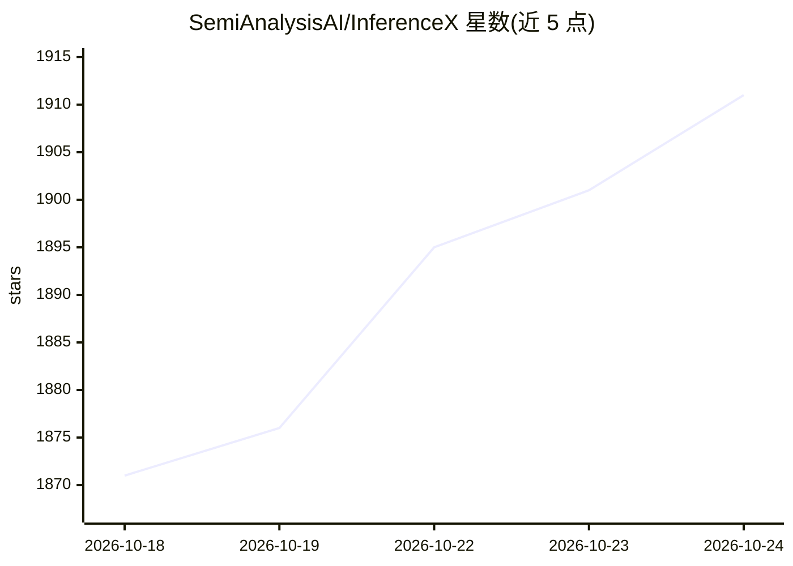

# SemiAnalysisAI/InferenceX

⭐ 1,913 · Python · Apache-2.0 · 推送 2026-10-24 · [GitHub](https://github.com/SemiAnalysisAI/InferenceX) · [官网](https://inferencex.com/) · 组织维护 · 中文 README

**开源 LLM 推理性能持续基准测试与仪表盘平台**

由 SemiAnalysis 维护的开源推理研究平台，对主流开源推理框架（SGLang、vLLM、TensorRT-LLM 等）在多种 GPU/加速器硬件（NVIDIA Blackwell/Hopper、AMD MI 系列、TPU 等）上进行自动化、持续更新的端到端推理服务基准测试，并以在线仪表盘免费公开结果。仓库含端到端服务基准、集合通信基准、算子/内核级基准与系统级功耗建模等子项目；另发布 AgentX 长上下文多轮 Agent 基准。实验性子项目标注为 Beta。

## 筛选速览

| 维度 | 判定 | 备注 |
|---|---|---|
| AI 角色 | `ai-ecosystem` | LLM/agent 周边工具 |
| 许可风险 | `permissive` | Apache-2.0 |
| 部署形态 | `None` |  |
| 模型依赖 | — | README 未给出锁定关系 |
| 硬件要求 | — | 无带数字的原话,不猜 |
| 安装摩擦 | `medium` | 含编译或系统依赖之一 |
| 成熟度 | `idea` | |

## 能力要点

- 端到端推理服务基准 + 网络/集合通信与算子内核级基准（Beta）
- 官方支持 13+ 种 GPU/XPUs 硬件 SKU，另有多种 Coming Soon
- Apache 2.0 开源，公开免费在线仪表盘持续更新
- AgentX：百万级长上下文多轮 Agent 基准

## 适用场景

- 对比推理框架在不同 GPU 硬件上的实时性能
- 跟踪新模型（DeepSeek、Kimi、GLM 等）Day 0 之后的持续基准结果
- 为推理服务选型参考端到端与内核级性能数据

## 场景标签

`模型评测` · 领域:评测与运维

## 证据(README 行号)

> L41: InferenceX™ (formerly InferenceMAX) is an inference performance research platform dedicated to continually analyzin
> L55: AI software like SGLang, vLLM, TensorRT-LLM, CUDA, ROCm and achieve this continuous improvement in performance thro
> L61: |SKU|Status|

## 星数曲线

2026-10-18 1,871 → 2026-10-24 1,911（+40）

---
*卡片 v1 · prompt 1.4 · 生成 2026-10-21 · 置信度 high · 依据 README sha `297838171270` · [字段定义](../../DATASET.md)*
