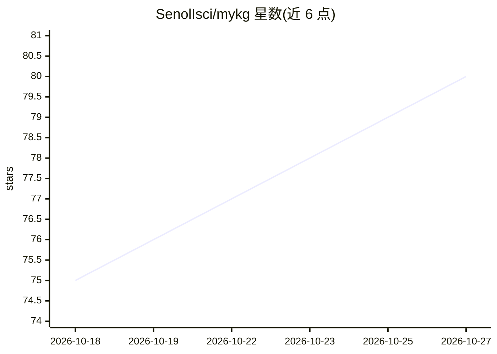

# SenolIsci/mykg

⭐ 80 · Python · MIT · 推送 2026-10-23 · [GitHub](https://github.com/SenolIsci/mykg) · 个人维护

**把混合文档目录转换成基于归纳本体的置信度知识图谱引擎**

Python 库 + CLI 工具，用两遍 LLM 流水线处理文档目录：第一遍从语料归纳全局 RDFS/OWL schema（TTL 可在 Protégé 中检查），第二遍按 schema 抽取带类型与置信度评分的实体和关系。支持 Markdown、PDF、Word、PPT、Excel、HTML、图片及网站/GitHub 仓库抓取。输出 JSONL（Neo4j/NetworkX/RAG）、Turtle RDF、NetworkX 格式、Obsidian vault 与交互式 HTML 图。支持 Anthropic/OpenAI/Gemini/Ollama/OpenRouter 等多种 provider，提供 MCP server、增量更新、跨会话合并与 schema 漂移检测。

## 筛选速览

| 维度 | 判定 | 备注 |
|---|---|---|
| AI 角色 | `ai-ecosystem` | LLM/agent 周边工具 |
| 许可风险 | `permissive` | MIT |
| 部署形态 | `library` | 以包/库形式分发 |
| 模型依赖 | local-ok | 支持本地模型 |
| 硬件要求 | — | 无带数字的原话,不猜 |
| 安装摩擦 | `low` | 无编译、无系统依赖或容器化 |
| 成熟度 | — | 结构信号不足 |

## 能力要点

- 两遍 LLM 流水线：归纳 RDFS/OWL 本体后按 schema 抽取实体关系
- 每个节点、边、属性带 0.0–1.0 置信度评分
- 五种输出族：JSONL / Turtle RDF / NetworkX / Obsidian vault / Neo4j LOAD CSV
- mykg mcp-serve 暴露 16 个只读查询工具给 MCP 客户端

## 适用场景

- 把个人笔记或项目文档整理成可查询的知识图谱
- 为 AI 编码助手提供基于自有文档的项目上下文（Obsidian vault）
- 将文档语料转成 Neo4j / RDF 格式用于图分析与 RAG

## 场景标签

`知识图谱` `网页抓取` · 领域:效率与自动化

## 证据(README 行号)

> L17: **myKG** automatically generates a confidence-scored knowledge graph from a set of mixed documents — Markdown, plai
> L65: - **Provider-agnostic** — works with Anthropic (Claude), OpenAI (GPT), Google Gemini, Ollama (local), OpenRouter, o
> L136: It uses a **two-pass LLM pipeline**: Pass 1 induces a global RDFS/OWL schema from your document corpus; Pass 2 ext

## 星数曲线

2026-10-18 75 → 2026-10-27 80（+5）

---
*卡片 v1 · prompt 1.4 · 生成 2026-10-24 · 置信度 mid · 依据 README sha `95f655723466` · [字段定义](../../DATASET.md)*
