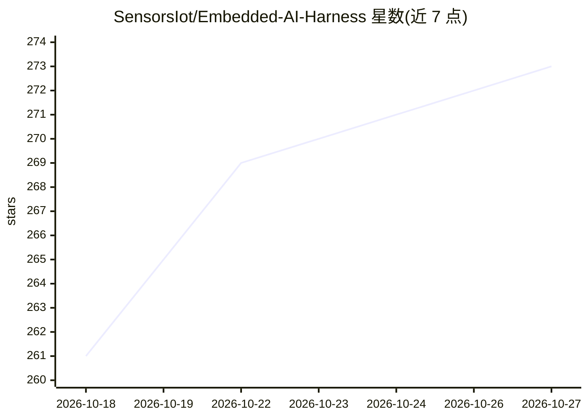

# SensorsIot/Embedded-AI-Harness

⭐ 273 · Python · MIT · 推送 2026-10-09 · [GitHub](https://github.com/SensorsIot/Embedded-AI-Harness) · 个人维护

**让 AI 在真实 ESP32 硬件上闭环写码、烧录、测试的开发工具链**

面向嵌入式开发者的 AI 闭环编程系统：由四个 Claude Code 技能（/define、/harness、/commission、/build）组成方法论，配合树莓派测试台（testbench）把烧录、复位、串口观测、WiFi/BLE/MQTT/RF 测试变成 HTTP API 与 70 个 MCP 工具，供 Claude Desktop/Claude Code 调用，AI 据此在真实 ESP32 上迭代直到测试通过。固件构建走 GitHub Actions 固定容器。限制：每板仅一个写串口会话、API 无鉴权、需与测试台同局域网。

## 筛选速览

| 维度 | 判定 | 备注 |
|---|---|---|
| AI 角色 | `ai-ecosystem` | LLM/agent 周边工具 |
| 许可风险 | `permissive` | MIT |
| 部署形态 | `library` | 以包/库形式分发 |
| 模型依赖 | locked-api |  |
| 硬件要求 | — | 无带数字的原话,不猜 |
| 安装摩擦 | `low` | 无编译、无系统依赖或容器化 |
| 成熟度 | — | 结构信号不足 |

## 能力要点

- 树莓派测试台将烧录/复位/串口/调试/GPIO 变为 HTTP API 与 70 个 MCP 工具
- 四个阶段技能驱动 AI 闭环：FSD 规格→搭台→调试→构建，阶段门由项目状态派生
- 固件由 GitHub Actions 固定容器构建，测试台烧录 CI 产物而非本地二进制
- 槽位身份机制：同一 USB 口即同一端口，换板不失效

## 适用场景

- 让 Claude Code 在真实 ESP32 硬件上自动写固件、烧录、跑测试并自我修正
- 搭建多板远程测试台做嵌入式 CI 与发布验证
- 通过对话式 MCP 工具操作测试台排查崩溃与启动问题

## 场景标签

`编码 Agent` · 领域:编码与开发

## 证据(README 行号)

> L19: harness: strap the AI in, and it pulls — writes the code, compiles it, flashes
> L68: - **The method** — four Claude Code skills, one per phase: `/define` (the
> L148: - **Claude drives all of it** through 70 MCP tools or the bundled skills.

## 星数曲线

2026-10-18 261 → 2026-10-27 273（+12）

---
*卡片 v1 · prompt 1.4 · 生成 2026-10-22 · 置信度 mid · 依据 README sha `6b727dfe2bf3` · [字段定义](../../DATASET.md)*
