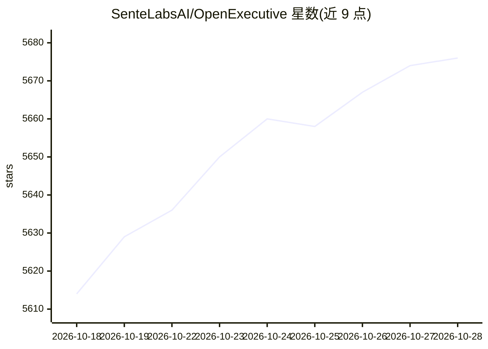

# SenteLabsAI/OpenExecutive

⭐ 5,684 · Python · Apache-2.0 · 推送 2026-10-27 · [GitHub](https://github.com/SenteLabsAI/OpenExecutive) · [官网](https://openexecutive.ai) · 组织维护

**开源虚拟高管团队：一个统一决策人设背后由 9 个专家 agent 支撑**

由 SenteLabs 开发的 AI 高管助手应用：以单一一致的执行人设对外，内部由 CSO/CFO/COO 等 9 个专家 agent 分工（编排器用 claude-sonnet-5-5，深推理任务用 claude-opus-5-5）。支持支出审批阈值、企业知识库 RAG（ChromaDB 双层检索）、跨会话情景记忆（SQLite）、内置调度器，以及 Act as me 代拟邮件。集成 Slack/Discord/Telegram/Google Workspace/Microsoft 365/Notion/Confluence 与任意 MCP 客户端。后端 FastAPI + Next.js 15，自部署需 Python 3.11+ 与 Node 22.6+；API 须单实例运行。

## 筛选速览

| 维度 | 判定 | 备注 |
|---|---|---|
| AI 角色 | `ai-native` | 本体是模型或模型工具 |
| 许可风险 | `permissive` | Apache-2.0 |
| 部署形态 | `desktop` | 安装包/桌面程序 |
| 模型依赖 | local-ok | 支持本地模型 |
| 硬件要求 | — | 无带数字的原话,不猜 |
| 安装摩擦 | `low` | 无编译、无系统依赖或容器化 |
| 成熟度 | — | 结构信号不足 |

## 能力要点

- 9 个专家 agent（战略/财务/法务/销售/董事会沟通等）对外呈现单一高管声音
- 双层 RAG：内置 MBA 级知识 + 上传公司文档（ChromaDB）
- 跨会话情景记忆：后台 haiku 抽取决策入 SQLite，下次会话注入 <past_decisions>
- Act as me：用管理者自己的 Gmail 代拟邮件供其审阅发送

## 适用场景

- 企业以 AI 高管人设获取战略、财务、法务等领域咨询
- 忙碌管理者用数字孪生代拟邮件并保留最终决定权
- 通过 Slack/Discord/Telegram 等既有工作渠道对话
- 接入公司 Notion/Confluence/网盘构建企业知识问答

## 场景标签

`多智能体` `RAG` `AI 助手` · 领域:Agent 开发

## 证据(README 行号)

> L41: Executive Orchestrator (claude-sonnet-5-5)
> L61: |LLM backbone|Anthropic Claude API|

## 星数曲线

2026-10-18 5,614 → 2026-10-28 5,676（+62）

---
*卡片 v1 · prompt 1.4 · 生成 2026-10-20 · 置信度 high · 依据 README sha `f57ac007e2f0` · [字段定义](../../DATASET.md)*
