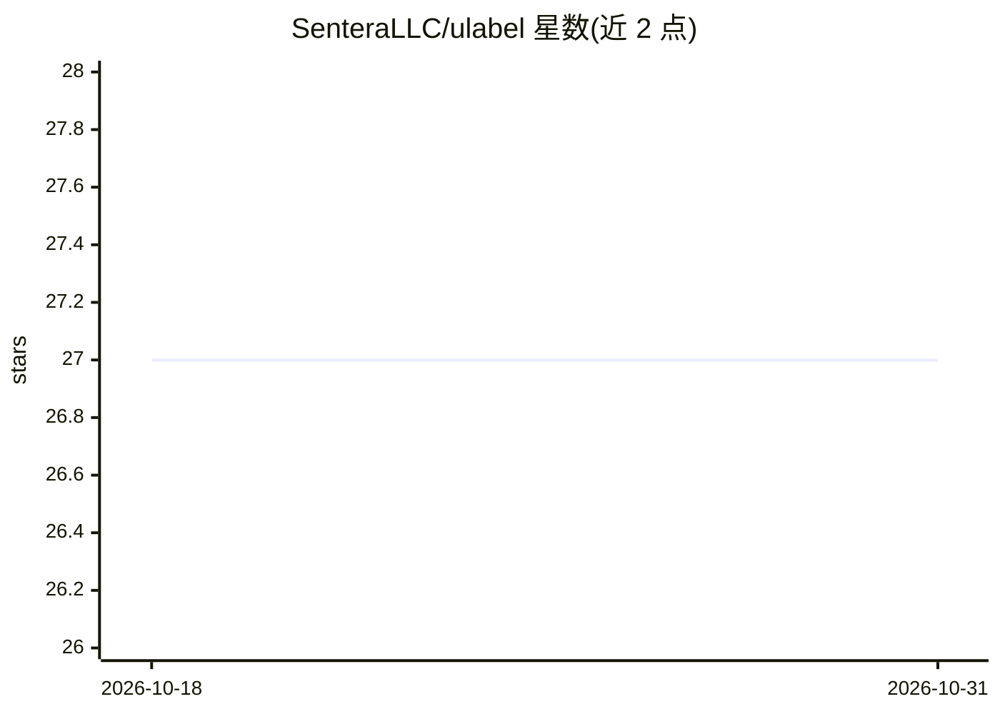

# SenteraLLC/ulabel

⭐ 27 · JavaScript · MIT · 推送 2026-10-30 · [GitHub](https://github.com/SenteraLLC/ulabel) · 组织维护

**浏览器端图像标注工具，为视觉任务制作训练数据**

纯前端 JavaScript 库：通过 unpkg CDN 或 npm 安装后嵌入任意 HTML 页面，即可创建图像标注会话；支持在 JavaScript 中直接 import，并提供 React 项目集成示例。面向需要为计算机视觉/医学影像等任务构建标注数据集的开发者。开发需 npm 与 nodejs，仓库自带构建好的 dist 文件，demo.js 从 demo/ 目录起静态服务（localhost:8080）。

## 筛选速览

| 维度 | 判定 | 备注 |
|---|---|---|
| AI 角色 | `ai-ecosystem` | LLM/agent 周边工具 |
| 许可风险 | `permissive` | MIT |
| 部署形态 | `library` | 以包/库形式分发 |
| 模型依赖 | — | README 未给出锁定关系 |
| 硬件要求 | — | 无带数字的原话,不猜 |
| 安装摩擦 | `low` | 无编译、无系统依赖或容器化 |
| 成熟度 | — | 结构信号不足 |

## 能力要点

- 纯前端工具，经 CDN 或 npm 嵌入任意 HTML 页面
- 支持 minified 与 debug 两种引入方式
- 提供 React 项目集成示例
- demo.js 本地静态服务便于开发测试

## 适用场景

- 在自有网页应用中嵌入图像标注功能
- 为计算机视觉/医学影像项目制作标注数据集
- 参考 ulabel-react-demo 集成到 React 工程

## 场景标签

 · 领域:计算机视觉/数据标注

## 证据(README 行号)

> L3: A browser-based tool for annotating images.
> L11: ULabel is an entirely "frontend" tool. It can be incorporated into any HTML page using either the unpkg cdn

## 星数曲线

2026-10-18 27 → 2026-10-31 27（+0）

---
*卡片 v1 · prompt 1.4 · 生成 2026-10-26 · 置信度 high · 依据 README sha `298492ffe86d` · [字段定义](../../DATASET.md)*
