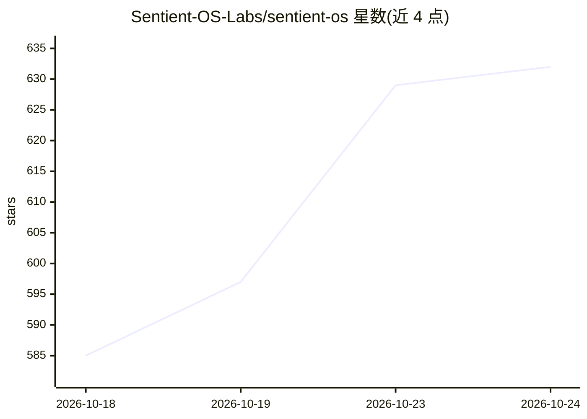

# Sentient-OS-Labs/sentient-os

⭐ 632 · Swift · AGPL-3.0 · 推送 2026-10-20 · [GitHub](https://github.com/Sentient-OS-Labs/sentient-os) · [官网](https://sentient-os.ai) · 组织维护

**Mac 上的端侧个人 AI：夜间理解你的资料，白天代你操作电脑**

面向 macOS 用户的开源个人 AI 桌面应用。夜间在本地（3 AM 唤醒机制）读取文件、截图、iMessage、WhatsApp、Apple Notes/Mail/Calendar 等来源，用端侧模型生成摘要，再由用户选定的模型整合为 Markdown 知识库（~/Sentient OS - Knowledge Base/）。白天提供三项能力：Sidekick 计算机使用代理（自有光标代操作应用）、双击右 Command 起草回复（草稿不自动发送）、以及主动式晨间建议。支持用户自选模型（含兼容本地模型），知识库可经 AES-256-GCM 加密后通过 MCP 中继共享。需 Apple silicon M1+、macOS 15.4+、8 GB RAM、约 10 GB 空间。

## 筛选速览

| 维度 | 判定 | 备注 |
|---|---|---|
| AI 角色 | `ai-native` | 本体是模型或模型工具 |
| 许可风险 | `dual` | AGPL-3.0 |
| 部署形态 | `None` |  |
| 模型依赖 | local-ok | 支持本地模型 |
| 硬件要求 | — | 无带数字的原话,不猜 |
| 安装摩擦 | `low` | 无编译、无系统依赖或容器化 |
| 成熟度 | — | 结构信号不足 |

## 能力要点

- Sidekick 计算机使用代理：自有光标在用户应用中代为点击、输入、传文件
- 夜间 3 AM 唤醒 Mac 做端侧理解，生成连接式 Markdown 知识库
- 双击右 Command 起草个人风格回复，草稿保持未发送
- 知识库为普通 Markdown 文件夹，可选 AES-256-GCM 加密 MCP 共享

## 适用场景

- 把半填的申请表、报销单、CRM 更新等杂务交由代理接手
- 在邮件/Slack/iMessage 中双击快速起草带上下文的回复
- 晨间获得基于个人资料的待办提醒与草稿建议

## 场景标签

`知识库管理` `GUI 自动化` `AI 助手` · 领域:效率与自动化

## 证据(README 行号)

> L5: Sentient OS is an open-source personal AI for your Mac. It understands the context of your life and work overnight, 
> L29: **Sentient does the catching up before you ask.** Overnight, it builds a connected understanding of the sources you
> L113: At **3 AM**, Sentient can wake your plugged-in Mac, even with the lid closed. It reads what's new in the local sou

## 星数曲线

2026-10-18 585 → 2026-10-24 632（+47）

---
*卡片 v1 · prompt 1.4 · 生成 2026-10-22 · 置信度 high · 依据 README sha `66a4c5ded7b8` · [字段定义](../../DATASET.md)*
