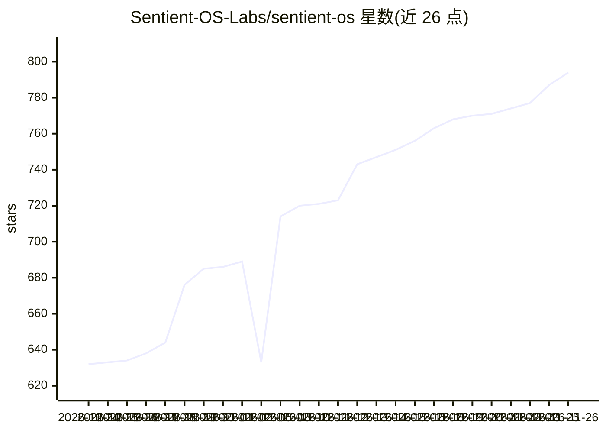

# Sentient-OS-Labs/sentient-os

⭐ 794 · Swift · AGPL-3.0 · 推送 2026-11-25 · [GitHub](https://github.com/Sentient-OS-Labs/sentient-os) · [官网](https://sentient-os.ai) · 组织维护

**Mac 上的本地个人 AI：理解你的生活上下文并代为执行任务**

面向 macOS 的开源个人 AI 应用：夜间在本机读取用户选定的本地来源（文件、截图、iMessage、Apple Notes/Mail/Calendar 等），生成 Markdown 格式的个人知识库；白天 Sidekick 通过独立光标在用户自己的应用中执行指派任务，Magic Reply 在两步内起草回复，并主动发现待办事项供用户批准执行。本地推理处理高频理解，用户可自选云端或本地模型；brew 安装，要求 Apple Silicon M1+、macOS 15.4+。

## 筛选速览

| 维度 | 判定 | 备注 |
|---|---|---|
| AI 角色 | `ai-native` | 本体是模型或模型工具 |
| 许可风险 | `dual` | AGPL-3.0 |
| 部署形态 | `None` |  |
| 模型依赖 | local-ok | 支持本地模型 |
| 硬件要求 | — | 无带数字的原话,不猜 |
| 安装摩擦 | `low` | 无编译、无系统依赖或容器化 |
| 成熟度 | `idea` | |

## 能力要点

- 本机模型夜间处理本地来源，知识库为普通 Markdown 文件夹
- Sidekick 用独立光标在用户应用中点击、输入、切换窗口
- Magic Reply 支持独立模型设置，含兼容本地模型，草稿不自动发送
- 主动情报：夜间准备草稿与提醒，用户点击后才执行

## 适用场景

- 让 AI 代为完成浏览器里填到一半的表格与申请
- 在 Gmail/Slack/iMessage 中快速起草带上下文的回复
- 早晨查看 AI 准备的逾期回复、订阅续费、报销草稿
- 小团队分担客户跟进与表单填报类琐事

## 场景标签

`AI 助手` `知识库管理` `GUI 自动化` · 领域:效率与自动化

## 证据(README 行号)

> L5: Sentient OS is an open-source personal AI for your Mac. It understands the context of your life and work overnight, 
> L7: **On-device understanding. Your choice of AI. Knowledge you own.** We do the high-volume understanding on your Mac, 
> L121: Your files, saved screenshots, iMessage, WhatsApp, Apple Notes, **Apple Mail and Apple Calendar** can all feed the

## 星数曲线

2026-10-24 632 → 2026-11-26 794（+162）

---
*卡片 v1 · prompt 1.4 · 生成 2026-11-24 · 置信度 high · 依据 README sha `9bdd47447b78` · [字段定义](../../DATASET.md)*
