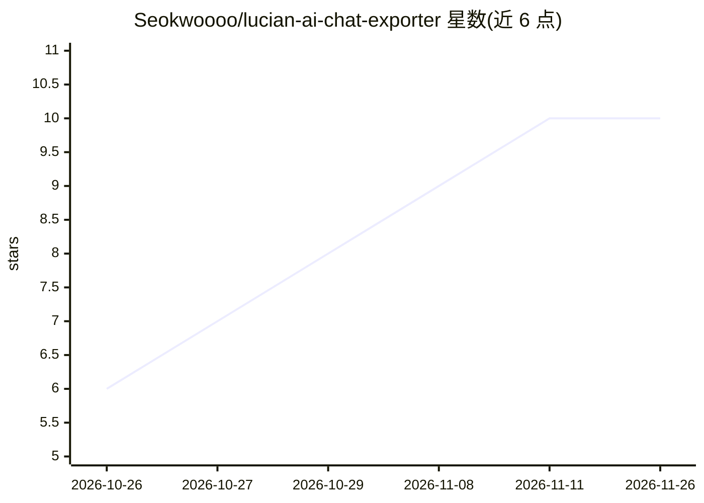

# Seokwoooo/lucian-ai-chat-exporter

⭐ 10 · TypeScript · MIT · 推送 2026-10-24 · [GitHub](https://github.com/Seokwoooo/lucian-ai-chat-exporter) · [官网](https://lucianlabs.dev/ai-chat-exporter/) · 个人维护

**给 ChatGPT/Claude/Gemini/Grok 用户做一键对话交接与多格式导出的 Chrome 扩展**

Manifest V3 Chrome 扩展，支持 ChatGPT、Claude、Gemini、Grok 四个站点。功能一：生成结构化交接 Markdown 文件（含目标、决策、未完成事项、关键代码等分区，每项带原文位置标记），附给其他 AI 即可继续任务；功能二：将完整对话导出为 Markdown、PDF、TXT、Word、HWPX、HTML、JSON 与 ZIP 备份。核心机制为规则式 TypeScript 抽取，不调用 LLM 或外部 API，全部处理在浏览器内完成，缓存存于本地 IndexedDB 并按 7 天清理。限制：PDF 需经打印窗口手动选择，Gemini 思考过程与来源不解析，Word/HWPX 公式保留 LaTeX 原文。

## 筛选速览

| 维度 | 判定 | 备注 |
|---|---|---|
| AI 角色 | `ai-ecosystem` | LLM/agent 周边工具 |
| 许可风险 | `permissive` | MIT |
| 部署形态 | `None` |  |
| 模型依赖 | — | README 未给出锁定关系 |
| 硬件要求 | — | 无带数字的原话,不猜 |
| 安装摩擦 | `low` | 无编译、无系统依赖或容器化 |
| 成熟度 | — | 结构信号不足 |

## 能力要点

- 规则式抽取生成交接 Markdown，不调用 LLM/外部 API，条目带 [#m12] 原文位置标记
- 交接文档按 token 预算做覆盖式压缩，约为全量导出的 12%
- 支持 Markdown/PDF/TXT/Word/HWPX/HTML/JSON/ZIP 多格式导出与逐次验证报告
- 全程浏览器内处理，无服务器、无账号、无统计工具

## 适用场景

- 在多个 AI 服务间切换时把当前任务交接给另一个 AI 继续
- 长期保存含代码、公式、图片、附件的完整对话
- 对导出文档做完整性核对（消息数、图片、附件）

## 场景标签

 · 领域:AI 对话工具/浏览器扩展

## 证据(README 行号)

> L8: ChatGPT·Claude·Gemini·Grok 대화를 **한 번의 클릭으로 다른 AI에게 인수인계**하거나, **전체 대화를 PDF·Markdown·Word·한글(HWPX) 등으로 내보내는** Chrome 
> L100: |수집 방식|내부 API + DOM 대체 경로|내부 API + DOM 대체 경로|batchexecute + DOM 대체 경로|REST + DOM 대체 경로|

## 星数曲线

2026-10-26 6 → 2026-11-26 10（+4）

---
*卡片 v1 · prompt 1.4 · 生成 2026-11-20 · 置信度 high · 依据 README sha `ef83b64b1dfb` · [字段定义](../../DATASET.md)*
