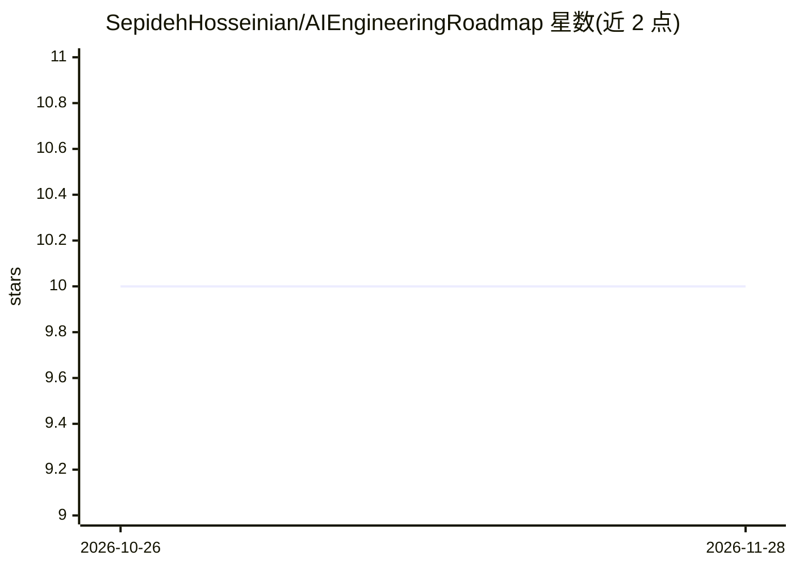

# SepidehHosseinian/AIEngineeringRoadmap

⭐ 10 · Python · 推送 2026-05-12 · [GitHub](https://github.com/SepidehHosseinian/AIEngineeringRoadmap) · 个人维护

**面向工程师的 AI 工程（GenAI/RAG/Agent）学习路线图**

面向软件工程师、ML 工程师与架构师的教学指南仓库，按 AI 产品全生命周期组织为六个模块：系统设计、架构模式（RAG/Agent 工作流）、性能优化、开发与评估、LLMOps 部署、可观测性维护。内容为知识点与项目式大纲（如高并发 AI FAQ 系统设计），并附工具清单（LangChain、vLLM、MLflow 等）。README 声明为 Work in Progress，尚在学习路线/清单阶段，未提供可安装的软件产物。

## 筛选速览

| 维度 | 判定 | 备注 |
|---|---|---|
| AI 角色 | `ai-knowledge` | 知识聚合/清单类 |
| 许可风险 | `none` | — |
| 部署形态 | `None` |  |
| 模型依赖 | — | README 未给出锁定关系 |
| 硬件要求 | — | 无带数字的原话,不猜 |
| 安装摩擦 | `low` | 无编译、无系统依赖或容器化 |
| 成熟度 | `idea` | |

## 能力要点

- 按 AI 产品全生命周期组织的六个学习模块（设计→部署→运维）
- 覆盖 RAG 架构、Agentic 工作流、量化/剪枝等主题
- 提供 MLflow、vLLM、LangChain 等工具的策展清单
- 含项目式练习（如高并发 AI FAQ 系统设计）

## 适用场景

- 软件工程师转型 AI 工程方向时按模块系统学习
- 准备将 AI 系统从原型推向生产环境的架构参考
- 了解 LLMOps 部署、评估与可观测性的知识范围

## 场景标签

`教程课程` · 领域:学习与行业

## 证据(README 行号)

> L3: Welcome to the AI Engineering Roadmap! This repository is a comprehensive guide for software engineers, ML engineers
> L9: The repository is structured into logical modules, covering the entire lifecycle of an AI product:
> L53: A curated list of tools we explore in this roadmap:

## 星数曲线

2026-10-26 10 → 2026-11-28 10（+0）

---
*卡片 v1 · prompt 1.4 · 生成 2026-11-20 · 置信度 high · 依据 README sha `38f40133273c` · [字段定义](../../DATASET.md)*
