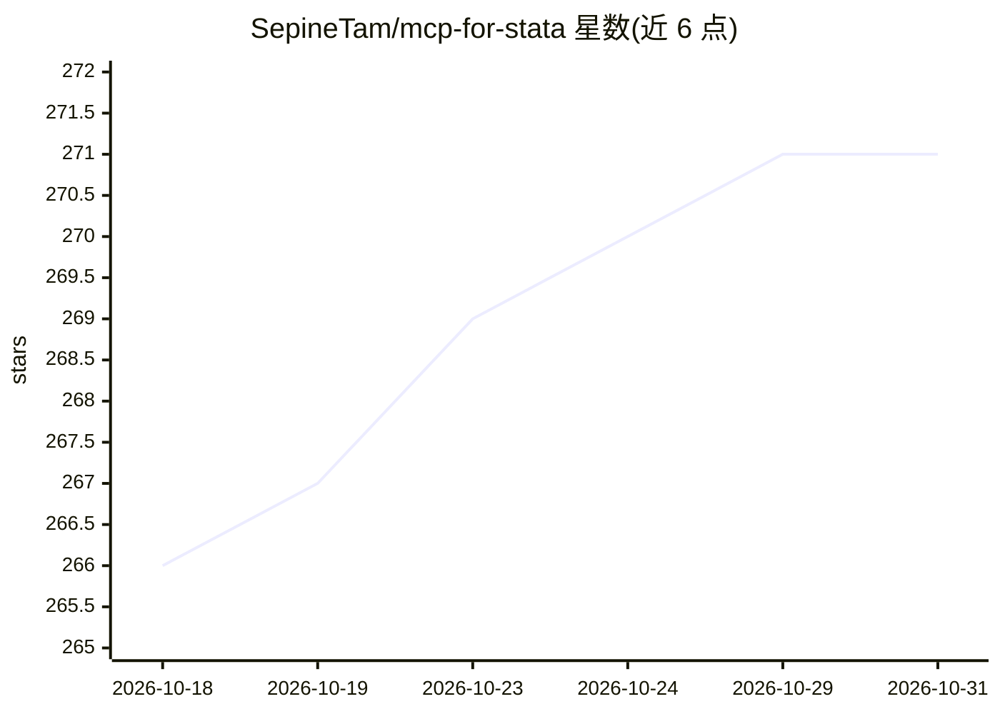

# SepineTam/mcp-for-stata

⭐ 271 · Python · AGPL-3.0 · 推送 2026-10-19 · [GitHub](https://github.com/SepineTam/mcp-for-stata) · [官网](https://aidea-labs.com/open/projects/mcp-for-stata) · 个人维护 · 中文 README

**让 AI agent 调用本地 Stata 做回归与实证研究的 MCP 服务器**

面向实证研究者的开源 MCP 服务器与 CLI 工具：将本地 Stata 接入 Claude Code、Codex、OpenClaw 等 AI agent，用于回归分析、计量经济学、论文复现；提供命令防护、资源监控、自动日志捕获与跨平台客户端一键安装，用户保留对数据与 Stata 许可证的控制。默认随附 Stata 相关 Skills，支持 Claude Code 插件（含 Stata LSP 集成）。前置条件包括 uv、已安装的 agent、Stata 许可证与 LLM API key；许可为 AGPL-3.0（因抄袭事件从 Apache-2.0 变更）。

## 筛选速览

| 维度 | 判定 | 备注 |
|---|---|---|
| AI 角色 | `ai-ecosystem` | LLM/agent 周边工具 |
| 许可风险 | `viral` | AGPL-3.0 |
| 部署形态 | `library` | 以包/库形式分发 |
| 模型依赖 | locked-api |  |
| 硬件要求 | — | 无带数字的原话,不猜 |
| 安装摩擦 | `low` | 无编译、无系统依赖或容器化 |
| 成熟度 | — | 结构信号不足 |

## 能力要点

- uvx stata-mcp install --all 一键为多个 agent 客户端安装
- 命令防护、资源监控与自动日志捕获的安全设计
- 内置 Stata Skills 与 Stata LSP 插件集成
- 支持 Claude Code/Codex/OpenClaw/Cursor/Gemini CLI 等客户端

## 适用场景

- 让 Claude Code 或 Codex 代跑回归、复现经济学论文
- 通过对话让 agent 检查和优化 Stata do 文件
- 借助 AI 解释复杂统计输出与回归结果

## 场景标签

`科研工具` · 领域:学习与行业

## 证据(README 行号)

> L7: MCP-for-Stata is an safety first open-source MCP server and CLI tool with Skills lets any AI agent you use invoke lo
> L35: - 🚀 **DeepSeek Harness Day 0 Support**: Install MCP-for-Stata in DeepSeek Harness with `uvx stata-mcp install -c ds
> L80: uvx stata-mcp install --all

## 星数曲线

2026-10-18 266 → 2026-10-31 271（+5）

---
*卡片 v1 · prompt 1.4 · 生成 2026-10-22 · 置信度 high · 依据 README sha `28be1492a059` · [字段定义](../../DATASET.md)*
