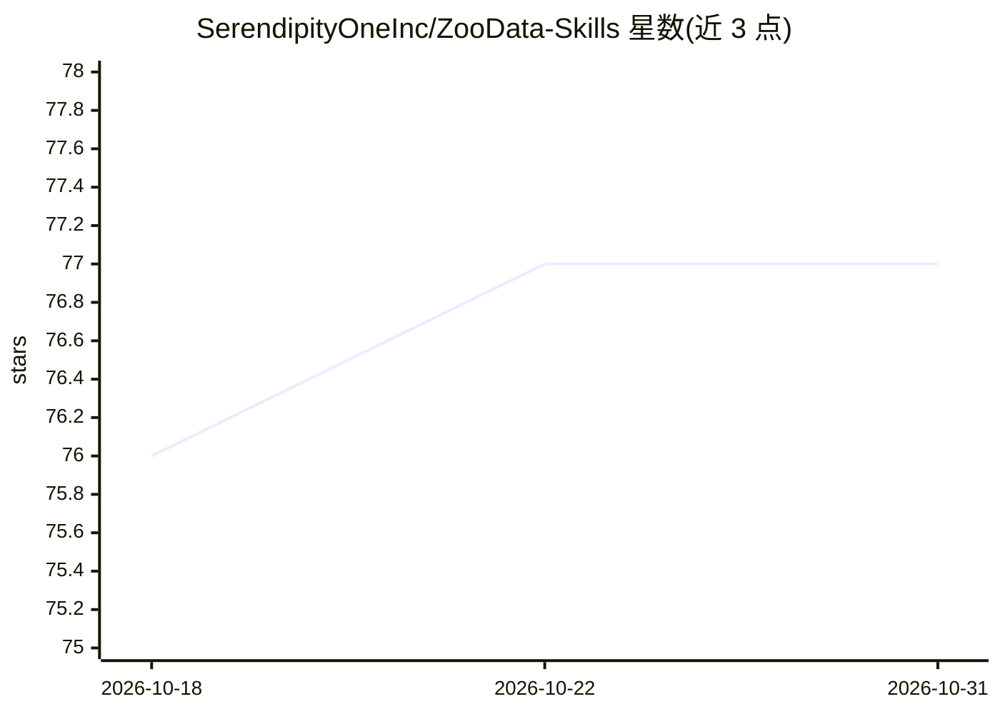

# SerendipityOneInc/ZooData-Skills

⭐ 77 · Python · MIT · 推送 2026-10-21 · [GitHub](https://github.com/SerendipityOneInc/ZooData-Skills) · [官网](https://zoodata.ai/) · 组织维护 · 中文 README

**面向 AI agent 的亚马逊电商数据技能集：10 个技能接入商业数据 API**

由 SerendipityOne Inc. 维护的 agent 技能仓库，含 10 个技能分两层：基础层（36 个亚马逊商品与关键词智能端点直连、全谱分析、关键词流量分析、市场分析）与专业层（竞品情报监控、每日市场雷达、listing 八维审计、定价信号、评论洞察、公开网页结构化抽取）。通过 npx skills 安装到 AI agent，调用 ZooData 云端 API（需 API key，免费额度 1,000 credits），覆盖 2 亿+ 商品与 10 亿+ 评论数据。CLI 为 Python 标准库实现，零 pip 依赖。

## 筛选速览

| 维度 | 判定 | 备注 |
|---|---|---|
| AI 角色 | `ai-ecosystem` | LLM/agent 周边工具 |
| 许可风险 | `permissive` | MIT |
| 部署形态 | `library` | 以包/库形式分发 |
| 模型依赖 | — | README 未给出锁定关系 |
| 硬件要求 | — | 无带数字的原话,不猜 |
| 安装摩擦 | `low` | 无编译、无系统依赖或容器化 |
| 成熟度 | — | 结构信号不足 |

## 能力要点

- 10 个 agent 技能覆盖选品、竞品、定价、评论与市场分析
- 基础技能直连 36 个亚马逊商业与关键词智能 API 端点
- 13 种预设产品搜索模式（CLI 端展开为具体过滤字段）
- Python 标准库实现，零 pip 依赖

## 适用场景

- 让我的 AI agent 直接查询亚马逊商品、评论与市场数据
- 通过对话完成竞品分析与选品研究
- 自动化每日监控价格变动、BSR 与评论异动

## 场景标签

`网页抓取` `数据分析` · 领域:效率与自动化

## 证据(README 行号)

> L30: This repo contains **10 agent skills** organized in two tiers:
> L59: npx skills add SerendipityOneInc/ZooData-Skills
> L105: **Base URL:** `https://api.zoodata.ai/openapi/v2`

## 星数曲线

2026-10-18 76 → 2026-10-31 77（+1）

---
*卡片 v1 · prompt 1.4 · 生成 2026-10-24 · 置信度 high · 依据 README sha `b25c8681897f` · [字段定义](../../DATASET.md)*
