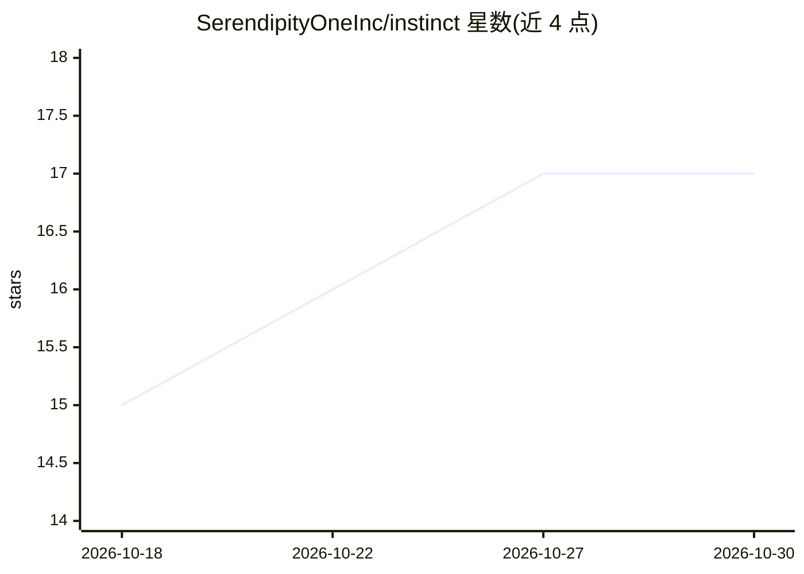

# SerendipityOneInc/instinct

⭐ 17 · Python · Apache-2.0 · 推送 2026-09-30 · [GitHub](https://github.com/SerendipityOneInc/instinct) · [官网](https://instinct.zoowork.ai) · 组织维护

**开放决策模型家族：单次前向输出候选概率，不生成文本**

ZooWork 团队（Serendipity One Inc.）发布的开放决策模型家族，包含三个基于 Qwen 权重的模型：前两个冻结原权重、仅添加推理时决策读出，第三个为决策任务微调版。给定共享上下文与类型化问题，直接返回二元判断 P(yes)、2-16 候选分布或有序评分分布，零生成 token。仓库提供共享请求契约、参考运行时、CLI、Python API、HTTP 参考服务器与托管 API。本地推理需 CUDA GPU（Ampere 及以上、BF16），tuned-4B 需单卡 24 GB，27B 需约 54 GB，且需 C 编译器（Triton 内核首次运行时编译）；transformers 版本锁定 5.16.1。参考服务器无认证/TLS/限流，仅供本机使用。

## 筛选速览

| 维度 | 判定 | 备注 |
|---|---|---|
| AI 角色 | `ai-native` | 本体是模型或模型工具 |
| 许可风险 | `permissive` | Apache-2.0 |
| 部署形态 | `self-host` | docker 或自建部署 |
| 模型依赖 | local-ok | 支持本地模型 |
| 硬件要求 | — | 无带数字的原话,不猜 |
| 安装摩擦 | `low` | 无编译、无系统依赖或容器化 |
| 成熟度 | — | 结构信号不足 |

## 能力要点

- 三种题型（noul/choice/score）统一类型化 API，output_tokens 报告为 0
- 基于 Qwen 权重的单 token 标签 logit 读出机制，不做文本生成
- 提供 CLI、Python 库、参考 HTTP 服务器与 ZooWork 托管 API
- 权重开放于 Hugging Face，tuned-4B 首次下载约 8.5 GB

## 适用场景

- 在应用中把共享上下文映射为二元判断或候选分布
- 需要结构化概率输出而非生成文本的分类/评分场景
- 本地 GPU 部署或直接调用托管 API 获取决策结果

## 场景标签

 · 领域:LLM 决策/分类模型

## 证据(README 行号)

> L13: Instinct turns shared context and typed questions into distributions over fixed candidates. It supports binary judg
> L41: - **Noul** — a yes/no proposition returned as `P(yes)` in `[0, 1]`.
> L45: - **Zero text generation** — responses contain structured answers and report `output_tokens: 0`.

## 星数曲线

2026-10-18 15 → 2026-10-30 17（+2）

---
*卡片 v1 · prompt 1.4 · 生成 2026-10-29 · 置信度 mid · 依据 README sha `667ece983d5c` · [字段定义](../../DATASET.md)*
