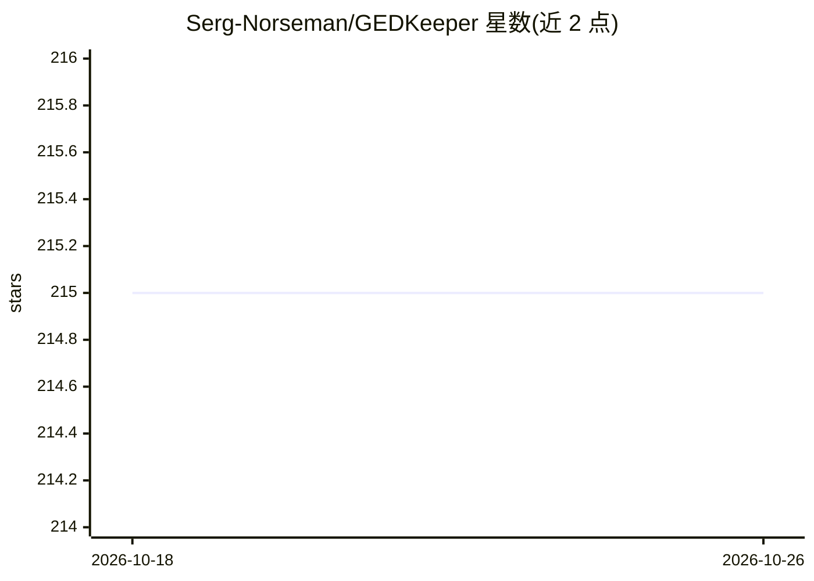

# Serg-Norseman/GEDKeeper

⭐ 215 · C# · GPL-3.0 · 推送 2026-10-25 · [GitHub](https://github.com/Serg-Norseman/GEDKeeper) · [官网](https://gedkeeper.net/) · 个人维护

**跨平台个人家谱数据库管理程序，支持 GEDCOM 标准与插件**

GEDKeeper 是用于管理个人家谱数据库的桌面程序：完整支持 GEDCOM 5.5.1 标准，人数与世代数无限制，可生成谱系、构建多种世系树并打印/保存图像，支持多媒体材料添加，地理数据可经 Google 地图与 OpenStreetMap 输出。功能可通过插件与 Lua 脚本扩展，其中 MCP Server 插件提供与 LLM 客户端的 MCP 与 RAG 集成。提供三个实现：GEDKeeper2（.NET Framework 4.8，Windows 旧版）、GEDKeeper3（.NET 8 跨平台，当前活跃维护）、GEDKeeperX（Android 移动版，已暂停支持）。

## 筛选速览

| 维度 | 判定 | 备注 |
|---|---|---|
| AI 角色 | `ai-enhanced` | 去掉 AI 部分产品仍成立 |
| 许可风险 | `viral` | GPL-3.0 |
| 部署形态 | `None` |  |
| 模型依赖 | — | README 未给出锁定关系 |
| 硬件要求 | — | 无带数字的原话,不猜 |
| 安装摩擦 | `medium` | 含编译或系统依赖之一 |
| 成熟度 | — | 结构信号不足 |

## 能力要点

- 完整支持 GEDCOM 5.5.1 标准，人数与世代数无限制
- 多种世系树构建、打印与图像保存，地图展示地理数据
- 插件与 Lua 脚本扩展机制，含 MCP Server 插件接入 LLM 客户端
- GEDKeeper3 跨平台实现（Linux/macOS/Windows 10/11）

## 适用场景

- 建立并维护个人家谱数据库
- 生成谱系与世系树图表用于打印或分享
- 通过插件和 Lua 脚本扩展家谱分析功能

## 场景标签

 · 领域:家谱/个人数据库工具

## 证据(README 行号)

> L11: The **GEDKeeper** program is for working with personal genealogical databases.
> L48: The current implementation is actively supported on a cross-platform framework.

## 星数曲线

2026-10-18 215 → 2026-10-26 215（+0）

---
*卡片 v1 · prompt 1.4 · 生成 2026-10-22 · 置信度 high · 依据 README sha `eadfcffc0ef7` · [字段定义](../../DATASET.md)*
