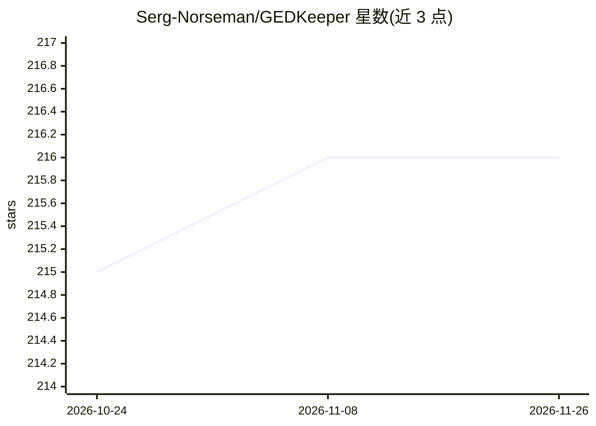

# Serg-Norseman/GEDKeeper

⭐ 216 · C# · GPL-3.0 · 推送 2026-11-25 · [GitHub](https://github.com/Serg-Norseman/GEDKeeper) · [官网](https://gedkeeper.net/) · 个人维护

**个人家谱数据库管理软件，支持 GEDCOM 与多平台**

用于管理个人家谱数据库的桌面/移动程序，完整支持 GEDCOM 5.5.1 标准。功能包括谱系生成、多种树形图的打印与导出、导航/过滤/搜索、多媒体附件，以及通过 Google 地图与 OpenStreetMap 输出地理数据。人数与世代数无限制。通过插件与 Lua 脚本扩展功能；GEDKeeper3 提供 MCP Server 插件，可与 LLM 客户端经 MCP 和 RAG 集成。提供三个实现：Windows 专用的 GK2、跨平台 GK3、移动端 GKX。

## 筛选速览

| 维度 | 判定 | 备注 |
|---|---|---|
| AI 角色 | `ai-enhanced` | 去掉 AI 部分产品仍成立 |
| 许可风险 | `viral` | GPL-3.0 |
| 部署形态 | `None` |  |
| 模型依赖 | — | README 未给出锁定关系 |
| 硬件要求 | — | 无带数字的原话,不猜 |
| 安装摩擦 | `medium` | 含编译或系统依赖之一 |
| 成熟度 | — | 结构信号不足 |

## 能力要点

- 完整支持 GEDCOM 5.5.1 标准
- 插件与 Lua 脚本扩展机制
- GEDKeeper3 提供 MCP Server 插件，可经 MCP/RAG 与 LLM 客户端集成
- 三个实现覆盖 Windows、Linux、macOS、Android、iOS

## 适用场景

- 整理和保存个人家族史数据
- 生成并打印家谱树形图
- 在家谱记录中关联照片等多媒体与地理位置

## 场景标签

 · 领域:家谱/个人数据库工具

## 证据(README 行号)

> L11: The **GEDKeeper** program is for working with personal genealogical databases.
> L49: Integration with LLM clients via the MCP and RAG is available MCP Server plugin.

## 星数曲线

2026-10-24 215 → 2026-11-26 216（+1）

---
*卡片 v1 · prompt 1.4 · 生成 2026-11-25 · 置信度 high · 依据 README sha `75db325efd95` · [字段定义](../../DATASET.md)*
