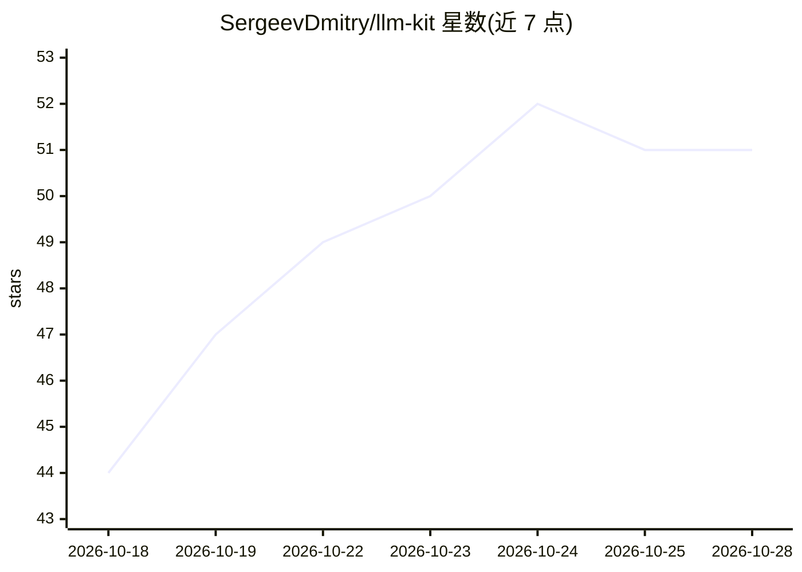

# SergeevDmitry/llm-kit

⭐ 51 · TypeScript · MIT · 推送 2026-10-18 · [GitHub](https://github.com/SergeevDmitry/llm-kit) · 个人维护

**面向 LLM 工程杂务的小型 TypeScript 包集合（分块/重试/计费等）**

六个互相独立、零运行时依赖（vec-cache 依赖 better-sqlite3）的 npm 包，处理构建 LLM 应用中的基础设施问题：截断 JSON 流修复、按 token 预算的语义分块、聊天历史裁剪（保持工具调用与结果原子性）、基于已提交定价数据的成本核算（十进制字符串精确计算）、读取限流头的退避重试、SQLite 嵌入缓存。不依赖任何 provider SDK、不发网络请求。要求 Node.js 20+，五个包可在浏览器/edge/Bun 运行；自述处于 pre-release 阶段。

## 筛选速览

| 维度 | 判定 | 备注 |
|---|---|---|
| AI 角色 | `ai-ecosystem` | LLM/agent 周边工具 |
| 许可风险 | `permissive` | MIT |
| 部署形态 | `library` | 以包/库形式分发 |
| 模型依赖 | — | README 未给出锁定关系 |
| 硬件要求 | — | 无带数字的原话,不猜 |
| 安装摩擦 | `low` | 无编译、无系统依赖或容器化 |
| 成熟度 | `idea` | |

## 能力要点

- 六个单职责独立包，五个包零运行时依赖且互不引用
- 成本核算以十进制字符串+整数运算保证精确，123 个模型/10 个 provider 的定价数据带来源 URL 与日期
- chat-fit 将工具调用与其结果作为原子组裁剪，避免请求被拒
- 不做网络调用、不依赖 provider SDK、不发遥测

## 适用场景

- 修复流式返回中被截断的 JSON 到合法部分值
- 把长对话或长文档按 token 预算分块且不拆散工具调用
- 按 provider×model 核算 LLM 调用成本并做带退避的重试
- 为嵌入计算加 SQLite 缓存以复用结果

## 场景标签

`LLM 可观测性` · 领域:评测与运维

## 证据(README 行号)

> L3: Small, focused npm packages for the unglamorous parts of building on LLMs —
> L22: Nothing here depends on a provider SDK, makes a network call, or sends
> L62: `mend-json`, `token-chunk`, `chat-fit`, `usage-tab` and `llm-backoff` also run

## 星数曲线

2026-10-18 44 → 2026-10-28 51（+7）

---
*卡片 v1 · prompt 1.4 · 生成 2026-10-24 · 置信度 high · 依据 README sha `45564836e793` · [字段定义](../../DATASET.md)*
