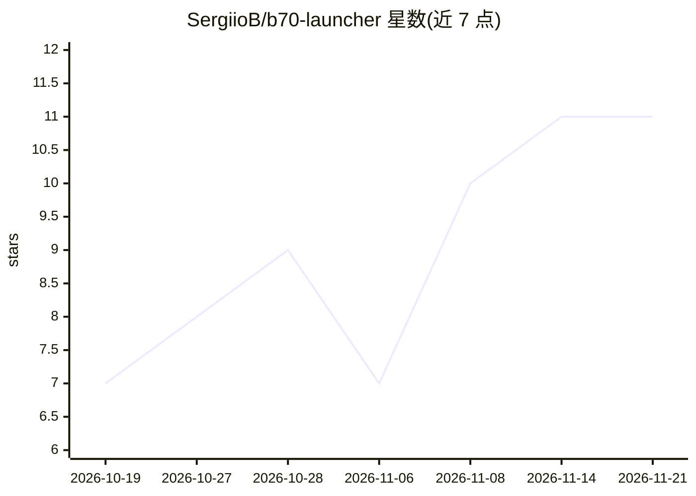

# SergiioB/b70-launcher

⭐ 11 · Python · MIT · 推送 2026-11-13 · [GitHub](https://github.com/SergiioB/b70-launcher) · [官网](https://xecores.com/match) · 个人维护

**面向 Intel Arc Pro B70 的本地 LLM 推理启动器**

Linux 桌面启动器，用于在 Intel Arc Pro B70 显卡上本地运行 LLM：从模型库选择模型，按配方选择推理引擎（vLLM XPU / llama.cpp SYCL / OpenVINO / EXL3），预览完整启动命令后启动并测试。纯 Python stdlib 实现，无 pip install、无捆绑二进制；支持多卡配方、会话存活重启接管、存储管理、每请求速度与能耗统计，可通过 CLI（b70 list/launch/stop 等）或桌面界面操作。

## 筛选速览

| 维度 | 判定 | 备注 |
|---|---|---|
| AI 角色 | `ai-ecosystem` | LLM/agent 周边工具 |
| 许可风险 | `permissive` | MIT |
| 部署形态 | `self-host` | docker 或自建部署 |
| 模型依赖 | local-ok | 支持本地模型 |
| 硬件要求 | — | 无带数字的原话,不猜 |
| 安装摩擦 | `low` | 无编译、无系统依赖或容器化 |
| 成熟度 | — | 结构信号不足 |

## 能力要点

- 配方化引擎选择：vLLM XPU / llama.cpp SYCL / OpenVINO / EXL3
- dry-run 命令预览，启动前可查看完整命令
- 存储管理器：按磁盘查看空间、模型删除进回收站
- 每请求记录首 token 时间、解码速率与显卡功耗
- 纯 Python stdlib，rootless，一条命令安装

## 适用场景

- 在 Intel Arc Pro B70 上选择引擎配方并启动本地模型
- 通过 CLI 或界面管理模型下载、存储与停止
- 为本地模型打开 agent（pi/omp/droid/codex/deepseek）
- 统计各 agent 的 token 用量与推理速度能耗

## 场景标签

`推理引擎` · 领域:训练与推理

## 证据(README 行号)

> L11: Local desktop launcher for LLM inference on the Intel Arc Pro B70. Model library → recipe pick (vLLM XPU / llama.cp
> L34: **How it works:** pick a model → pick an engine recipe (vLLM XPU / llama.cpp SYCL / OpenVINO / EXL3) → inspect the 
> L41: b70 launch qwen38-27b        # start a model and wait until it answers

## 星数曲线

2026-10-19 7 → 2026-11-21 11（+4）

---
*卡片 v1 · prompt 1.4 · 生成 2026-11-18 · 置信度 mid · 依据 README sha `3914d239b684` · [字段定义](../../DATASET.md)*
