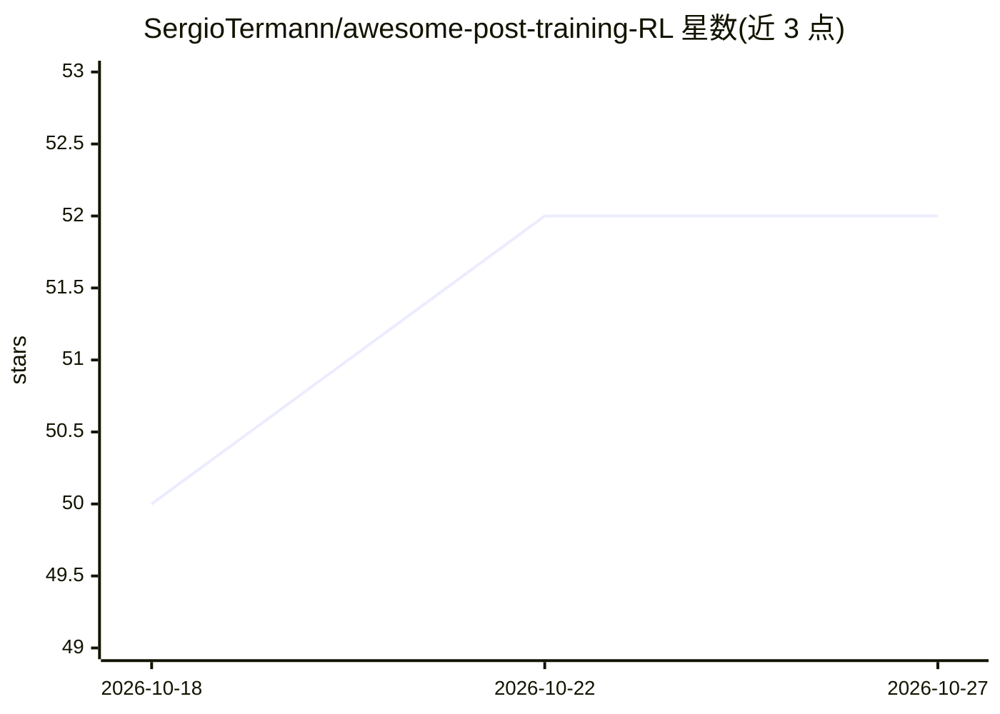

# SergioTermann/awesome-post-training-RL

⭐ 52 · MIT · 推送 2026-09-13 · [GitHub](https://github.com/SergioTermann/awesome-post-training-RL) · 个人维护 · 中文 README

**LLM 强化学习后训练论文策展清单（55 篇，7 类）**

面向 LLM 研究者与工程师的论文聚合清单：按 7 个类别收录 55 篇强化学习后训练论文，覆盖 RLHF 基础、偏好优化（DPO/KTO/ORPO/SimPO 等）、GRPO 系训练框架、推理 RL 里程碑、前沿模型技术报告（GLM-5、DeepSeek-V4、Kimi K3）、多智能体自博弈与 Agentic RL。每条目含作者、发表会议/年份与一句话方法摘要。无安装运行流程，仅供阅读检索，接受 PR 补充，MIT 许可。

## 筛选速览

| 维度 | 判定 | 备注 |
|---|---|---|
| AI 角色 | `ai-knowledge` | 知识聚合/清单类 |
| 许可风险 | `permissive` | MIT |
| 部署形态 | `None` |  |
| 模型依赖 | — | README 未给出锁定关系 |
| 硬件要求 | — | 无带数字的原话,不猜 |
| 安装摩擦 | `low` | 无编译、无系统依赖或容器化 |
| 成熟度 | — | 结构信号不足 |

## 能力要点

- 55 篇论文按 7 类组织并附方法关键词总表
- 覆盖 RLHF/PPO→DPO 系→GRPO 系到 Agentic RL 的脉络
- 条目含作者、会议与一句话摘要，接受 PR 补充

## 适用场景

- 系统梳理 LLM 后训练 RL 方法的论文脉络
- 按类别（偏好优化/GRPO 系/多智能体）快速定位相关论文
- 追踪前沿模型技术报告中的 RL 训练细节

## 场景标签

`精选清单` `强化学习` · 领域:学习与行业

## 证据(README 行号)

> L9: A curated list of papers on **reinforcement learning post-training** for large language models — from the foundation
> L15: |Category|Papers|Key methods|

## 星数曲线

2026-10-18 50 → 2026-10-27 52（+2）

---
*卡片 v1 · prompt 1.4 · 生成 2026-10-24 · 置信度 high · 依据 README sha `e3e73678c575` · [字段定义](../../DATASET.md)*
