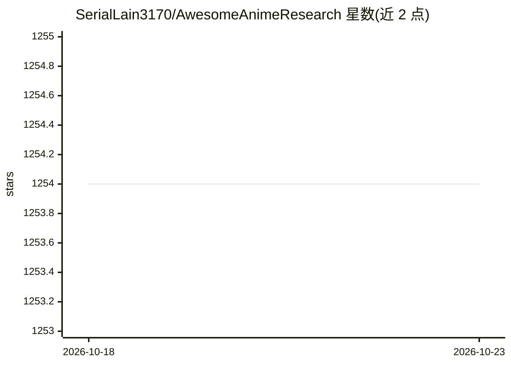

# SerialLain3170/AwesomeAnimeResearch

⭐ 1,254 · 推送 2026-07-20 · [GitHub](https://github.com/SerialLain3170/AwesomeAnimeResearch) · 个人维护

**动画/漫画研究的论文与数据集策展清单**

Awesome 系列的学术资源聚合仓库，收录动画与漫画方向的论文、数据集、基准与相关仓库链接。内容按数据集（含 2017-2025 年 AnimeScore、Manga109、CoMix 等）、基准、论文分类组织；论文部分细分为动画制作、图像生成（生成/Few-shot/可解释性/Montage/文生图）、图像翻译（Face 2 Anime、Selfie 2 Anime、Photo 2 Anime）等主题，以年份、会议/期刊、标题、链接四列表格呈现，接受社区补充遗漏条目。

## 筛选速览

| 维度 | 判定 | 备注 |
|---|---|---|
| AI 角色 | `ai-knowledge` | 知识聚合/清单类 |
| 许可风险 | `none` | — |
| 部署形态 | `None` |  |
| 模型依赖 | — | README 未给出锁定关系 |
| 硬件要求 | — | 无带数字的原话,不猜 |
| 安装摩擦 | `low` | 无编译、无系统依赖或容器化 |
| 成熟度 | — | 结构信号不足 |

## 能力要点

- 数据集与基准条目覆盖 2017-2026 年会议/期刊论文
- 论文按动画制作、图像生成、图像翻译等主题分类
- 每条含年份、发表场所、标题与代码/主页链接

## 适用场景

- 查找动画/漫画方向的公开数据集与基准
- 按主题追踪 GAN 动画生成与图像翻译的论文脉络
- 为相关研究寻找配套开源代码仓库

## 场景标签

`精选清单` · 领域:学习与行业

## 证据(README 行号)

> L7: ## 📂 Datasets
> L44: ## 📜 Papers

## 星数曲线

2026-10-18 1,254 → 2026-10-23 1,254（+0）

---
*卡片 v1 · prompt 1.4 · 生成 2026-10-21 · 置信度 high · 依据 README sha `b3353bb452f9` · [字段定义](../../DATASET.md)*
