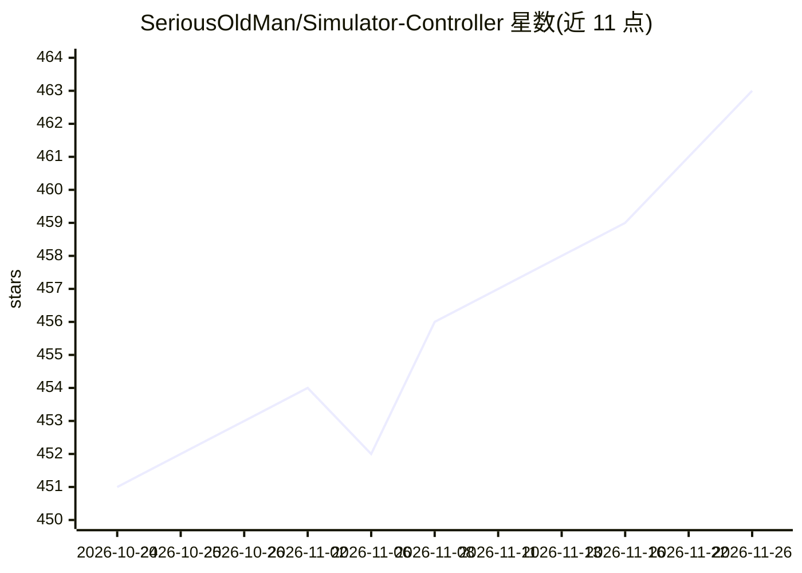

# SeriousOldMan/Simulator-Controller

⭐ 463 · AutoHotkey · NOASSERTION · 推送 2026-11-25 · [GitHub](https://github.com/SeriousOldMan/Simulator-Controller) · 个人维护

**为模拟赛车玩家提供 AI 车组助手与外设控制的应用套件**

面向 Sim Racing 的模块化管理与控制器应用，核心是可插拔的自动化框架，支持 Button Box 等外部控制硬件去操控 SimHub 等模拟器组件。附带多个基于 AI 的语音聊天助手：比赛工程师（进站准备、天气、损伤影响计算）、比赛策略师（依位置/交通/天气调整策略）、瞭望员（接近车辆警告）与驾驶教练（车辆操控指导）。提供 Windows 自动安装器与手动安装包，文档逾 900 页，配视频教程与 Discord 社区。

## 筛选速览

| 维度 | 判定 | 备注 |
|---|---|---|
| AI 角色 | `ai-enhanced` | 去掉 AI 部分产品仍成立 |
| 许可风险 | `none` | NOASSERTION |
| 部署形态 | `desktop` | 安装包/桌面程序 |
| 模型依赖 | local-ok | 支持本地模型 |
| 硬件要求 | — | 无带数字的原话,不猜 |
| 安装摩擦 | `low` | 无编译、无系统依赖或容器化 |
| 成熟度 | — | 结构信号不足 |

## 能力要点

- 四种 AI 语音比赛助手：工程师、策略师、瞭望员、驾驶教练
- 可插拔自动化框架，支持 Button Box 等外部控制硬件
- 策略模拟含燃料计算（Strategy Workbench）与轮胎/天气模型
- 自动安装器、稳定版/开发版多渠道分发，900+ 页文档

## 适用场景

- 比赛中语音获取进站、天气与策略建议，双手不离方向盘
- 用 Button Box、Stream Deck 等硬件控制模拟器功能
- 分析操控问题并自动修改车辆 setup 文件
- 管理团队赛事并共享遥测数据制定团队策略

## 场景标签

`聊天机器人` `语音 Agent` · 领域:对话与助手

## 证据(README 行号)

> L1: # Simulator Controller
> L3: Simulator Controller is a modular and extendable administration and controller application for Sim Racing. At the co

## 星数曲线

2026-10-24 451 → 2026-11-26 463（+12）

---
*卡片 v1 · prompt 1.4 · 生成 2026-11-26 · 置信度 high · 依据 README sha `941c9f75d26d` · [字段定义](../../DATASET.md)*
