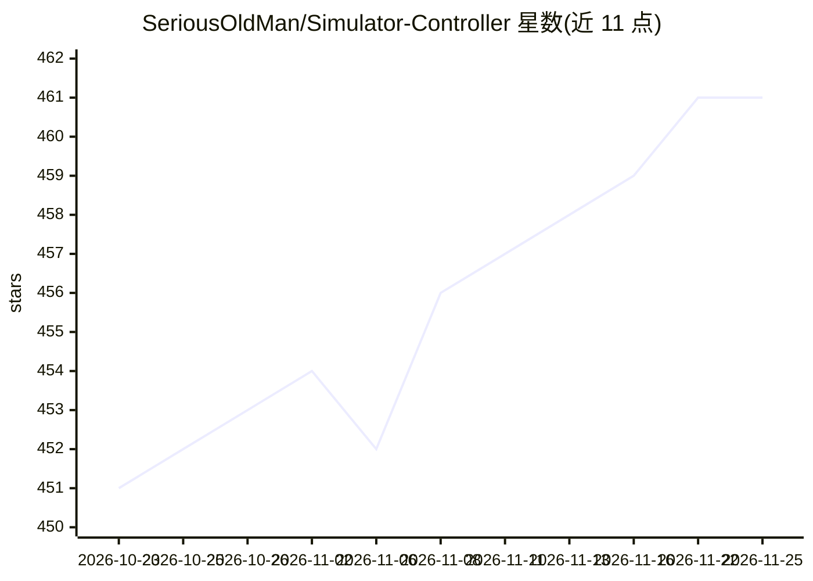

# SeriousOldMan/Simulator-Controller

⭐ 461 · AutoHotkey · NOASSERTION · 推送 2026-11-23 · [GitHub](https://github.com/SeriousOldMan/Simulator-Controller) · 个人维护

**为模拟赛车玩家提供 AI 车组助手与硬件自动化控制**

面向 Sim Racing 的模块化管理与控制应用，核心是一个可接入外部控制硬件（Button Boxes 等）的插件化自动化框架，可控制 SimHub、SimFeedback 等模拟器组件。内置多个基于人工智能技术的语音助手：Race Engineer 处理进站准备、天气预报与圈速影响计算，Race Strategist 依比赛位置、车流与天气变化制定策略，Race Spotter 警告附近车辆危险状况，Driving Coach 提供驾驶指导。通过自动化安装器或手动解压运行 Install.exe 安装，基于 AutoHotkey 构建，运行于 Windows，可能触发杀毒软件告警。

## 筛选速览

| 维度 | 判定 | 备注 |
|---|---|---|
| AI 角色 | `ai-enhanced` | 去掉 AI 部分产品仍成立 |
| 许可风险 | `none` | NOASSERTION |
| 部署形态 | `desktop` | 安装包/桌面程序 |
| 模型依赖 | — | README 未给出锁定关系 |
| 硬件要求 | — | 无带数字的原话,不猜 |
| 安装摩擦 | `low` | 无编译、无系统依赖或容器化 |
| 成熟度 | — | 结构信号不足 |

## 能力要点

- 四个语音 AI 助手：工程师、策略师、瞭望员、驾驶教练
- 插件化自动化框架，接入 Button Boxes 等控制硬件
- 语音命令控制应用与模拟游戏功能
- 900+ 页文档与 22 个视频教程

## 适用场景

- 比赛中用语音获取进站、天气与策略建议
- 通过 Button Box 等硬件控制模拟器组件
- 分析操控问题并生成车辆调校建议
- 管理车队比赛与遥测数据共享

## 场景标签

`语音 Agent` · 领域:对话与助手

## 证据(README 行号)

> L3: Simulator Controller is a modular and extendable administration and controller application for Sim Racing. At the co
> L17: The programming language used for building Simulator Controller uses some really nasty tricks to control Windows ap

## 星数曲线

2026-10-23 451 → 2026-11-25 461（+10）

---
*卡片 v1 · prompt 1.4 · 生成 2026-11-25 · 置信度 high · 依据 README sha `7d67e1d7d94c` · [字段定义](../../DATASET.md)*
