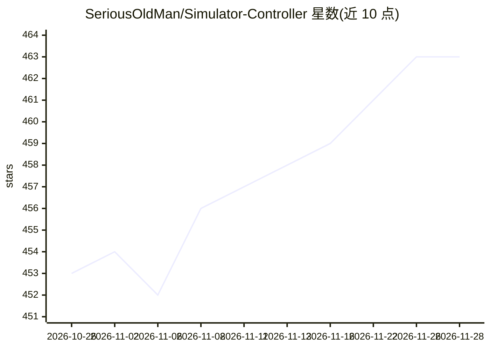

# SeriousOldMan/Simulator-Controller

⭐ 463 · AutoHotkey · NOASSERTION · 推送 2026-11-27 · [GitHub](https://github.com/SeriousOldMan/Simulator-Controller) · 个人维护

**模拟赛车玩家的 AI 赛车助手与自动化控制套件**

面向 Sim Racing 的模块化管理与控制应用，核心是可插拔的自动化框架，可接入 Button Box 等外部控制器硬件操控 SimHub 等模拟器组件。在此基础上提供多个基于 AI 的语音聊天助手：Race Engineer 负责进站准备、天气预报与圈速影响计算，Race Strategist 根据位置、车流与天气调整策略，Race Spotter 监视邻近车辆并预警，Driving Coach 提供驾驶指导。另含设置工作台、遥测数据库、团队赛事管理与 900+ 页文档。

## 筛选速览

| 维度 | 判定 | 备注 |
|---|---|---|
| AI 角色 | `ai-enhanced` | 去掉 AI 部分产品仍成立 |
| 许可风险 | `none` | NOASSERTION |
| 部署形态 | `desktop` | 安装包/桌面程序 |
| 模型依赖 | local-ok | 支持本地模型 |
| 硬件要求 | — | 无带数字的原话,不猜 |
| 安装摩擦 | `low` | 无编译、无系统依赖或容器化 |
| 成熟度 | — | 结构信号不足 |

## 能力要点

- 四个语音 AI 助手：工程师、策略师、瞭望员、驾驶教练
- 插件化自动化框架，支持 Button Box、Stream Deck 等硬件控制器
- Setup Workbench 自动分析操控问题并给出设置修改建议
- 提供自动化安装器及多版本安装包

## 适用场景

- 比赛中语音获取进站、天气与轮胎磨损建议
- 团队赛中共享遥测数据并制定团队策略
- 分析驾驶风格与车辆设置问题并自动改写设置文件

## 场景标签

`语音 Agent` · 领域:对话与助手

## 证据(README 行号)

> L3: Simulator Controller is a modular and extendable administration and controller application for Sim Racing. At the co
> L11: Installation is very easy. For first time users I recommand using the automated installer below. But there are diff

## 星数曲线

2026-10-26 453 → 2026-11-28 463（+10）

---
*卡片 v1 · prompt 1.4 · 生成 2026-11-28 · 置信度 high · 依据 README sha `4b8cd34d15e8` · [字段定义](../../DATASET.md)*
