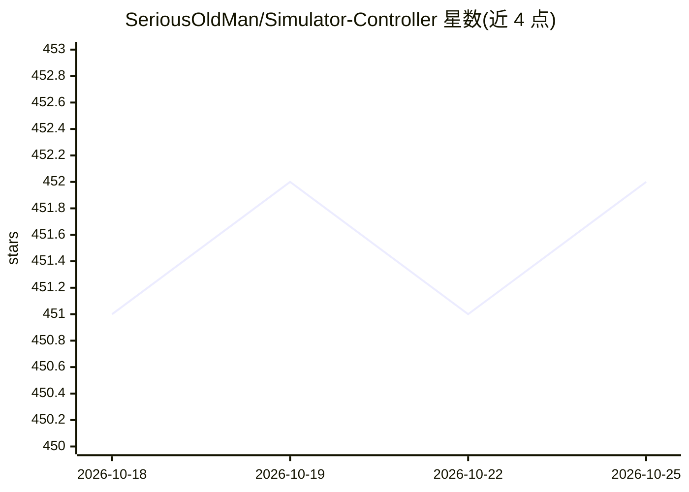

# SeriousOldMan/Simulator-Controller

⭐ 453 · AutoHotkey · NOASSERTION · 推送 2026-10-25 · [GitHub](https://github.com/SeriousOldMan/Simulator-Controller) · 个人维护

**Sim Racing 的模块化管理与控制工具，含多个 AI 赛事语音助手**

基于 AutoHotkey 的 Sim Racing 管理与控制应用：以插件化自动框架为核心，支持 Button Box、Stream Deck 等外设硬件控制 SimHub、SimFeedback 等模拟器组件，并提供四个基于人工智能的语音助手——AI Race Engineer 处理进站准备与天气监控、Race Strategist 制定与调整比赛策略、Race Spotter 警示周边车辆、AI Driving Coach 提供驾驶指导。另含燃油计算、赛道地图、遥测数据库、团队赛事管理与语音控制等功能。通过自动安装器或手动安装包在 Windows 上安装。

## 筛选速览

| 维度 | 判定 | 备注 |
|---|---|---|
| AI 角色 | `ai-enhanced` | 去掉 AI 部分产品仍成立 |
| 许可风险 | `none` | NOASSERTION |
| 部署形态 | `desktop` | 安装包/桌面程序 |
| 模型依赖 | local-ok | 支持本地模型 |
| 硬件要求 | — | 无带数字的原话,不猜 |
| 安装摩擦 | `low` | 无编译、无系统依赖或容器化 |
| 成熟度 | — | 结构信号不足 |

## 能力要点

- 插件化自动框架，支持 Button Box / Stream Deck 等外部控制器硬件
- 四个 AI 语音助手：Race Engineer、Race Strategist、Race Spotter、Driving Coach
- 支持语音控制与自定义语音命令
- 900 余页文档与 23 个视频教程

## 适用场景

- 比赛过程中让 AI Race Engineer 自动处理进站与天气应对
- 通过语音指挥助手并获取策略建议
- 用 Button Box 等硬件控制模拟器组件
- 团队赛事中共享遥测数据并远程控制进站设置

## 场景标签

`语音 Agent` · 领域:对话与助手

## 证据(README 行号)

> L3: Simulator Controller is a modular and extendable administration and controller application for Sim Racing. At the co
> L1: # Simulator Controller

## 星数曲线

2026-10-18 451 → 2026-10-25 452（+1）

---
*卡片 v1 · prompt 1.4 · 生成 2026-10-21 · 置信度 high · 依据 README sha `9f720c49c2c4` · [字段定义](../../DATASET.md)*
