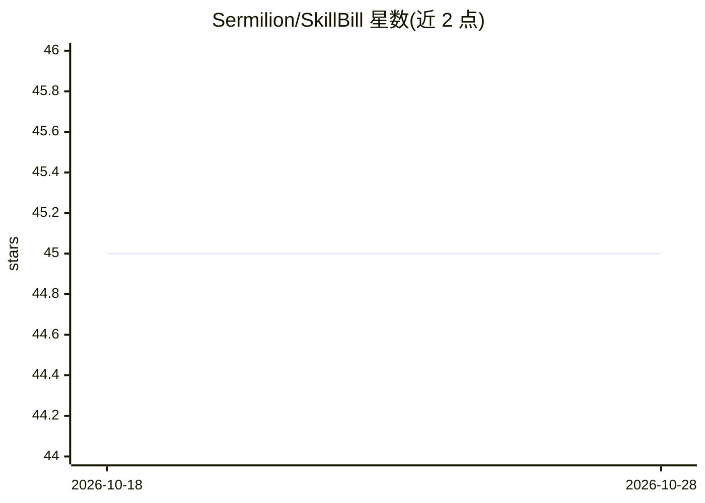

# Sermilion/SkillBill

⭐ 46 · Kotlin · MIT · 推送 2026-10-28 · [GitHub](https://github.com/Sermilion/SkillBill) · [官网](https://skillbill.dev) · 个人维护

**给 AI 编码 agent 的治理化功能工作流运行时：Issue 进、已审查 PR 出**

Skill Bill 是面向 AI 编码 agent 的技能与运行时：安装单个 `/skill-bill` 技能到 Claude Code、Codex、Cursor 等 agent 后，将 issue 与验收标准转化为 pull request。其 Kotlin 运行时按 intake→plan→implementation→audit→review→validation→QA→PR→monitor 等阶段执行，阶段状态写入本地数据库，崩溃或暂停后可恢复；审计将代码与测试逐条对照验收标准并修复缺口。支持大任务拆分为依赖有序子任务、移动端设备 QA、平台包按语言路由专家审查。项目自述 pre-1.0。

## 筛选速览

| 维度 | 判定 | 备注 |
|---|---|---|
| AI 角色 | `ai-ecosystem` | LLM/agent 周边工具 |
| 许可风险 | `permissive` | MIT |
| 部署形态 | `None` |  |
| 模型依赖 | — | README 未给出锁定关系 |
| 硬件要求 | — | 无带数字的原话,不猜 |
| 安装摩擦 | `medium` | 含编译或系统依赖之一 |
| 成熟度 | `idea` | |

## 能力要点

- 阶段状态存本地数据库，崩溃/暂停后可从断点恢复
- 验收标准逐条审计并修复，审查结果验证后修复 Blocker/Major
- 自动发现并运行项目自身检查，失败自动修复
- 提供桌面应用查看与控制运行，支持 phase/operation 子命令

## 适用场景

- 让编码 agent 从 issue 自动产出经过审计与测试的 PR
- 中断后恢复未完成的 agent 开发任务
- 对已有 PR 或改动做验收标准审计与修复

## 场景标签

`编码 Agent` · 领域:编码与开发

## 证据(README 行号)

> L14: Skill Bill turns an issue and its acceptance criteria into a pull request. It plans the work, implements it, audits
> L16: It works with Claude Code, Codex, and Cursor. You install one skill, `/skill-bill`, and review the result before me
> L20: - **Durable runs.** Phase outputs and continuation state live in a local database. Resume with any compatible agent

## 星数曲线

2026-10-18 45 → 2026-10-28 45（+0）

---
*卡片 v1 · prompt 1.4 · 生成 2026-10-25 · 置信度 high · 依据 README sha `0bd5f697949b` · [字段定义](../../DATASET.md)*
