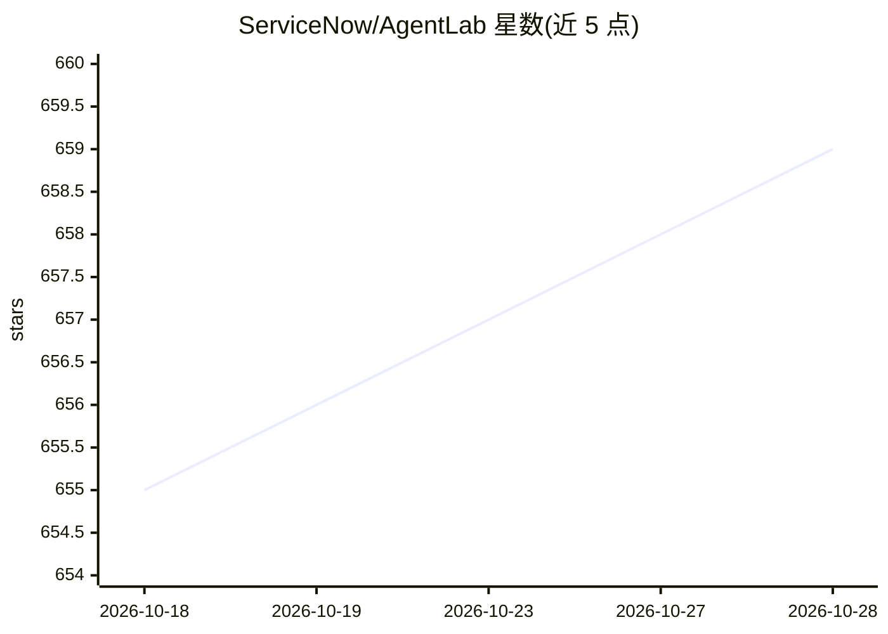

# ServiceNow/AgentLab

⭐ 659 · Python · NOASSERTION · 推送 2026-10-06 · [GitHub](https://github.com/ServiceNow/AgentLab) · 组织维护

**给 web agent 研究者的开发、评测与基准实验框架**

ServiceNow 维护的开源框架，基于 BrowserGym 支持的多个基准（WebArena、WorkArena、VisualWebArena、AssistantBench、MiniWoB、OSWorld 等）开发、运行和评测 web agent。提供基于 ray 的大规模并行实验、统一 LLM API（OpenRouter/OpenAI/Azure/自托管 TGI）、实验结果分析与 AgentXray 可视化、统一 Leaderboard 与多项可复现性功能（版本记录、复现实验上传、ReproducibilityAgent）。README 声明面向 web agent 研究、非消费产品。需要 Python 3.11/3.12 与 Playwright，部分基准需自行搭建托管环境。

## 筛选速览

| 维度 | 判定 | 备注 |
|---|---|---|
| AI 角色 | `ai-ecosystem` | LLM/agent 周边工具 |
| 许可风险 | `none` | NOASSERTION |
| 部署形态 | `library` | 以包/库形式分发 |
| 模型依赖 | locked-api |  |
| 硬件要求 | — | 无带数字的原话,不猜 |
| 安装摩擦 | `low` | 无编译、无系统依赖或容器化 |
| 成熟度 | — | 结构信号不足 |

## 能力要点

- 支持 15 个 web agent 基准（WebArena、WorkArena、AssistantBench、OSWorld 等）
- 基于 ray 的大规模并行实验，单机可并行 10–50 个作业
- 统一 LLM API：OpenRouter、OpenAI、Azure 或 TGI 自托管
- AgentXray 可视化 agent 执行轨迹与可复现性工具

## 适用场景

- 在多个 web 基准上运行和评测自研 agent
- 开展消融实验或随机搜索并并行跑上万个任务
- 可视化分析 agent 在任务上的逐步执行轨迹
- 向统一 Leaderboard 提交并复现实验结果

## 场景标签

`模型评测` · 领域:评测与运维

## 证据(README 行号)

> L26: AgentLab is a framework for developing and evaluating agents on a variety of
> L33: * Unified LLM API for OpenRouter, OpenAI, Azure, or self-hosted using TGI.

## 星数曲线

2026-10-18 655 → 2026-10-28 659（+4）

---
*卡片 v1 · prompt 1.4 · 生成 2026-10-22 · 置信度 high · 依据 README sha `bd180ebe4d46` · [字段定义](../../DATASET.md)*
