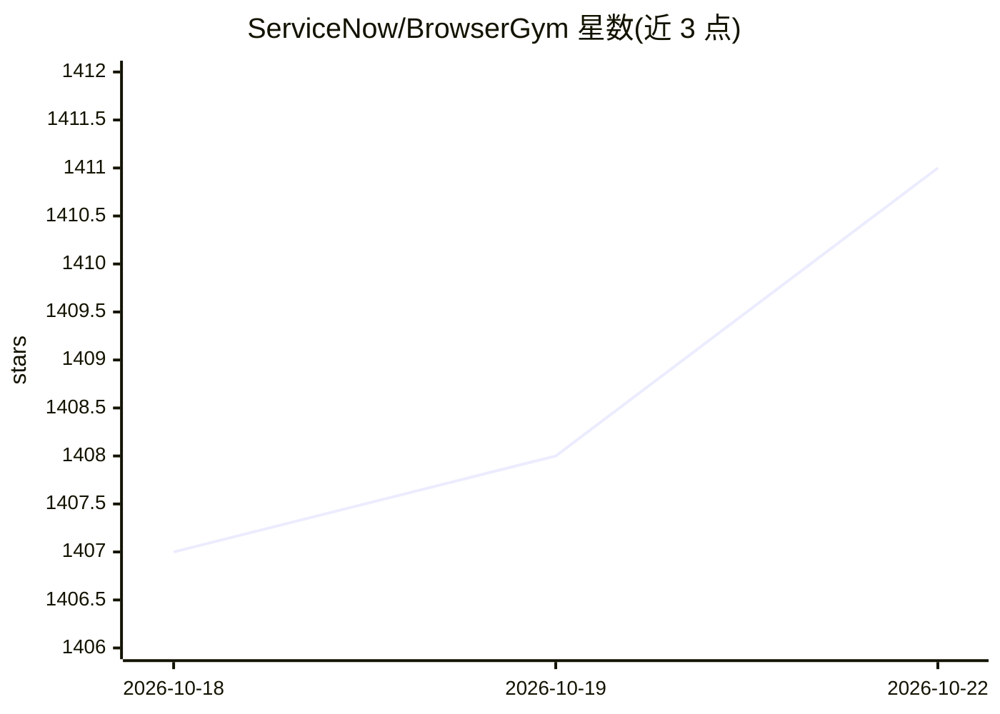

# ServiceNow/BrowserGym

⭐ 1,411 · Python · NOASSERTION · 推送 2026-10-21 · [GitHub](https://github.com/ServiceNow/BrowserGym) · 组织维护

**面向网页任务自动化的 Gym 环境：web agent 研究基准集合**

由 ServiceNow 维护的 Gymnasium 风格网页 agent 评测环境，内置 MiniWoB、WebArena、VisualWebArena、WorkArena、AssistantBench、TimeWarp、Knows 等 10 个基准；通过继承 AbstractBrowserTask 类可定义新基准任务。依赖 Playwright/Chromium 驱动浏览器，各基准有各自的额外配置步骤。附带使用 OpenAI 后端的 demo agent（默认 gpt-4o-mini，需 OPENAI_API_KEY），配套 AgentLab 用于运行与评估。README 声明面向 web agent 研究、非消费级产品。

## 筛选速览

| 维度 | 判定 | 备注 |
|---|---|---|
| AI 角色 | `ai-ecosystem` | LLM/agent 周边工具 |
| 许可风险 | `none` | NOASSERTION |
| 部署形态 | `library` | 以包/库形式分发 |
| 模型依赖 | — | README 未给出锁定关系 |
| 硬件要求 | — | 无带数字的原话,不猜 |
| 安装摩擦 | `medium` | 含编译或系统依赖之一 |
| 成熟度 | — | 结构信号不足 |

## 能力要点

- 内置 10 个网页任务基准（MiniWoB/WebArena/WorkArena 等）
- 继承 AbstractBrowserTask 即可创建新基准
- Gymnasium 接口注册任务，提供 openended 交互任务
- demo agent 使用 OpenAI 后端（默认 gpt-4o-mini，支持换模型与截图输入）

## 适用场景

- 在标准环境中训练和评测网页操作 agent
- 将多个网页基准统一到同一 Gym 接口下比较
- 为自建网页任务构建可复现的评测基准

## 场景标签

`浏览器自动化` `模型评测` · 领域:效率与自动化

## 证据(README 行号)

> L24: > BrowserGym is meant to provide an open, easy-to-use and extensible framework to accelerate the field of web agent
> L35: BrowserGym includes the following benchmarks by default:

## 星数曲线

2026-10-18 1,407 → 2026-10-22 1,411（+4）

---
*卡片 v1 · prompt 1.4 · 生成 2026-10-21 · 置信度 high · 依据 README sha `72ceb4f70d43` · [字段定义](../../DATASET.md)*
