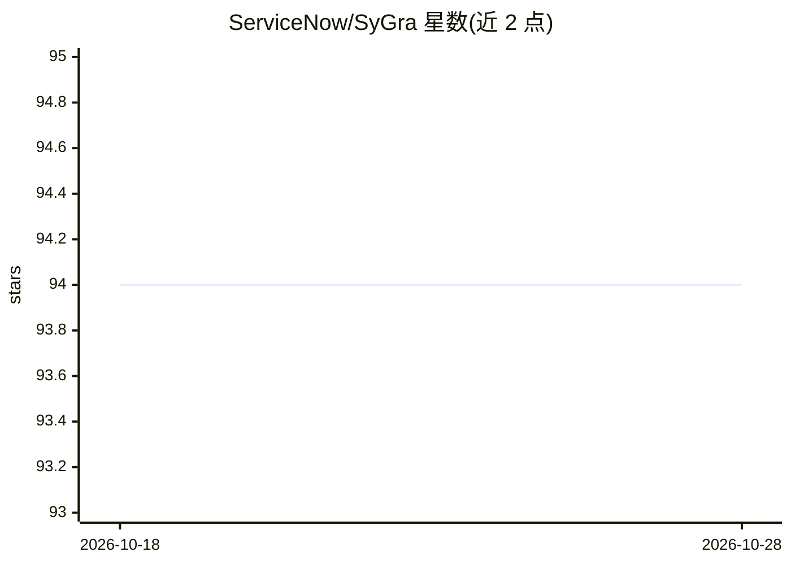

# ServiceNow/SyGra

⭐ 94 · Python · Apache-2.0 · 推送 2026-08-26 · [GitHub](https://github.com/ServiceNow/SyGra) · [官网](https://servicenow.github.io/SyGra/) · 组织维护

**面向合成数据生成的图式低代码流水线框架（含可视化 Studio）**

ServiceNow 维护的 Python 框架，将合成数据生成过程建模为计算图（底层用 LangGraph），以 YAML 或可视化拖拽（SyGra Studio）定义数据源（HuggingFace/文件系统/ServiceNow 实例）、节点（LLM 调用、多 LLM、lambda、采样器）、条件边与输出汇聚，用于生成 SFT/DPO 等训练数据。节点级支持预/后处理与提示模板，推理兼容 TGI、vLLM、OpenAI、Azure、Ollama 与 Triton 兼容服务，模型部署外部配置于 models.yaml。支持并行与一对多流，另提供评测任务模式与 token/延迟分析。

## 筛选速览

| 维度 | 判定 | 备注 |
|---|---|---|
| AI 角色 | `ai-ecosystem` | LLM/agent 周边工具 |
| 许可风险 | `permissive` | Apache-2.0 |
| 部署形态 | `library` | 以包/库形式分发 |
| 模型依赖 | local-ok | 支持本地模型 |
| 硬件要求 | — | 无带数字的原话,不猜 |
| 安装摩擦 | `low` | 无编译、无系统依赖或容器化 |
| 成熟度 | — | 结构信号不足 |

## 能力要点

- 计算图式流水线定义（YAML 或可视化 Studio 拖拽）
- 多种 LLM 推理后端：TGI/vLLM/OpenAI/Azure/Ollama/Triton
- 节点支持预处理、后处理与提示模板，边支持条件与并行流
- 内置评测任务模式（unit/aggregator 指标）

## 适用场景

- 低代码构建 SFT/DPO 训练数据生成流水线
- 用自批评循环等图结构生成代码问答类合成数据
- 在 Studio 中可视化监控数据生成任务的 token 用量与延迟

## 场景标签

 · 领域:LLM 训练数据/合成数据生成

## 证据(README 行号)

> L16: Framework to easily generate complex synthetic data pipelines by visualizing and configuring the pipeline as a
> L24: SyGra Framework is created to generate synthetic data. As it is a complex process to define the flow, this design s
> L134: As of now, LLM inference is supported for TGI, vLLM, OpenAI, Azure, Azure OpenAI, Ollama and Triton compatible ser

## 星数曲线

2026-10-18 94 → 2026-10-28 94（+0）

---
*卡片 v1 · prompt 1.4 · 生成 2026-10-23 · 置信度 high · 依据 README sha `fba93f0a5d78` · [字段定义](../../DATASET.md)*
