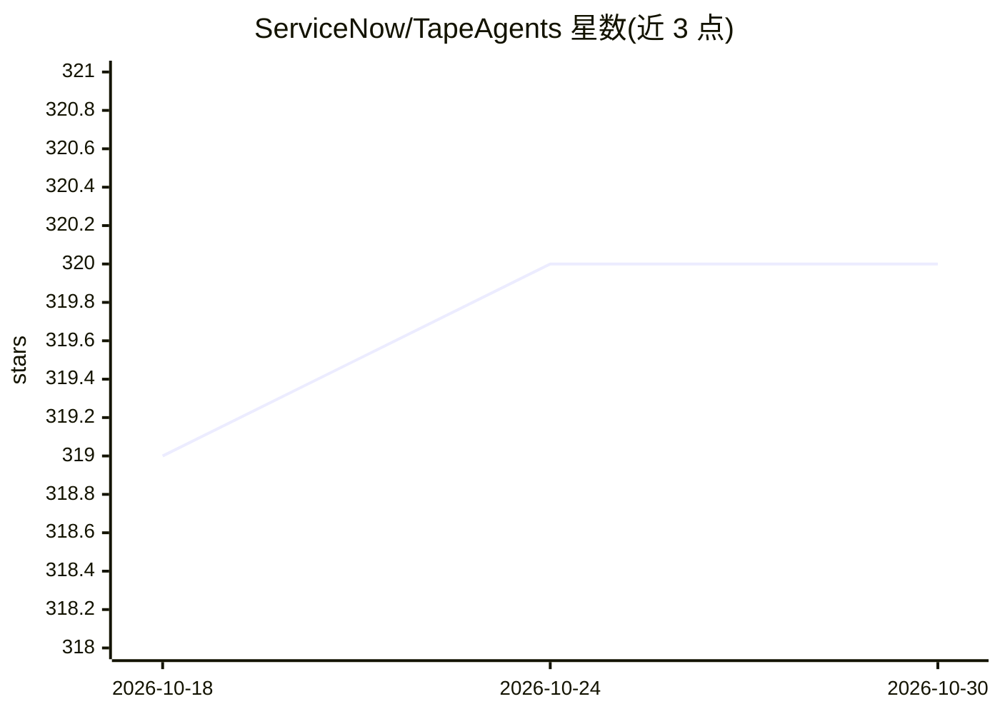

# ServiceNow/TapeAgents

⭐ 320 · Python · Apache-2.0 · 推送 2025-12-16 · [GitHub](https://github.com/ServiceNow/TapeAgents) · [官网](https://arxiv.org/abs/2412.08445) · 组织维护

**LLM Agent 开发全生命周期框架：以可回放 Tape 日志为核心**

ServiceNow 维护的 Python 框架，用结构化、可回放的会话日志（Tape）串联 LLM Agent 的构建、调试、部署与优化各阶段。支持以低层状态机、多 agent 团队或多提示词单体三种方式构建 agent；通过 TapeAgent studio 与 TapeBrowser 调试；支持流式响应服务；可基于成功 tape 优化 agent 配置，或用修订后的 tape 微调 LLM。提供入门 notebook、多个自包含示例（GAIA、GSM-8k、WorkArena）与 uv 源码构建流程。

## 筛选速览

| 维度 | 判定 | 备注 |
|---|---|---|
| AI 角色 | `ai-ecosystem` | LLM/agent 周边工具 |
| 许可风险 | `permissive` | Apache-2.0 |
| 部署形态 | `library` | 以包/库形式分发 |
| 模型依赖 | — | README 未给出锁定关系 |
| 硬件要求 | — | 无带数字的原话,不猜 |
| 安装摩擦 | `low` | 无编译、无系统依赖或容器化 |
| 成熟度 | — | 结构信号不足 |

## 能力要点

- 以结构化可回放的 Tape 日志驱动 agent 推理、调试与恢复
- 支持状态机、多 agent 团队、多提示词单体等构建方式
- 基于成功 tape 优化配置，用修订 tape 微调 LLM
- TapeAgent studio / TapeBrowser 调试工具与流式服务

## 适用场景

- 构建并调试多 agent 或单体 LLM agent 应用
- 用成功会话数据优化 agent 配置并微调模型
- 研究 tape 结构对 agent 开发流程的作用

## 场景标签

`Agent 框架` `多智能体` `微调` · 领域:Agent 开发

## 证据(README 行号)

> L10: **TapeAgents** is a framework that leverages a structured, replayable log (**Tape**) of the agent session to facili
> L19: - Optimize your agent's configuration using successful tapes; finetune the LLM using revised tapes.

## 星数曲线

2026-10-18 319 → 2026-10-30 320（+1）

---
*卡片 v1 · prompt 1.4 · 生成 2026-10-21 · 置信度 high · 依据 README sha `55ce65bff231` · [字段定义](../../DATASET.md)*
