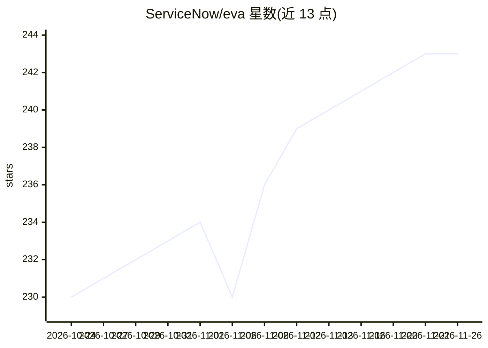

# ServiceNow/eva

⭐ 243 · Python · MIT · 推送 2026-11-25 · [GitHub](https://github.com/ServiceNow/eva) · [官网](https://servicenow.github.io/eva/) · 组织维护

**语音智能体端到端评测框架：同时评任务准确与对话体验**

EVA 是面向对话式语音智能体的开源评测框架，通过 bot-to-bot 架构全自动运行多轮语音对话并打分，无需人工听测。评分覆盖两个维度：EVA-A（任务完成准确性与忠实度）与 EVA-X（自然度、简洁性等口语交互体验）。内置 213 个企业场景、12 个级联与音频原生系统的结果、 judged prompts 与扰动套件（背景噪声、口音、连接劣化）。需配置 LLM/STT/TTS 与评测模型的 API 密钥；提供 CLI、Streamlit 配置编辑器与分析界面、Docker 运行方式及多语言扩展脚本。

## 筛选速览

| 维度 | 判定 | 备注 |
|---|---|---|
| AI 角色 | `ai-ecosystem` | LLM/agent 周边工具 |
| 许可风险 | `permissive` | MIT |
| 部署形态 | `self-host` | docker 或自建部署 |
| 模型依赖 | — | README 未给出锁定关系 |
| 硬件要求 | — | 无带数字的原话,不猜 |
| 安装摩擦 | `low` | 无编译、无系统依赖或容器化 |
| 成熟度 | — | 结构信号不足 |

## 能力要点

- bot-to-bot 全自动多轮语音对话评测，无需人工听测
- EVA-A/EVA-X 双维度指标，含 judged prompts 与验证数据集
- 扰动套件：背景噪声、口音变体、模拟连接劣化
- Streamlit 配置编辑器与结果分析界面，Docker 可运行

## 适用场景

- 在上线前对语音智能体做端到端自动化评测
- 用噪声/口音扰动测试语音智能体的鲁棒性
- 横向比较级联管线与语音到语音模型的表现
- 扩展新语言场景并计算 WER 指标

## 场景标签

`模型评测` · 领域:评测与运维

## 证据(README 行号)

> L11: **EVA** is an open-source evaluation framework for conversational voice agents that scores complete, multi-turn spo
> L16: Using a realistic **bot-to-bot architecture**, EVA runs fully automated evaluations without human listeners — end t

## 星数曲线

2026-10-24 230 → 2026-11-26 243（+13）

---
*卡片 v1 · prompt 1.4 · 生成 2026-11-25 · 置信度 high · 依据 README sha `941516c00082` · [字段定义](../../DATASET.md)*
