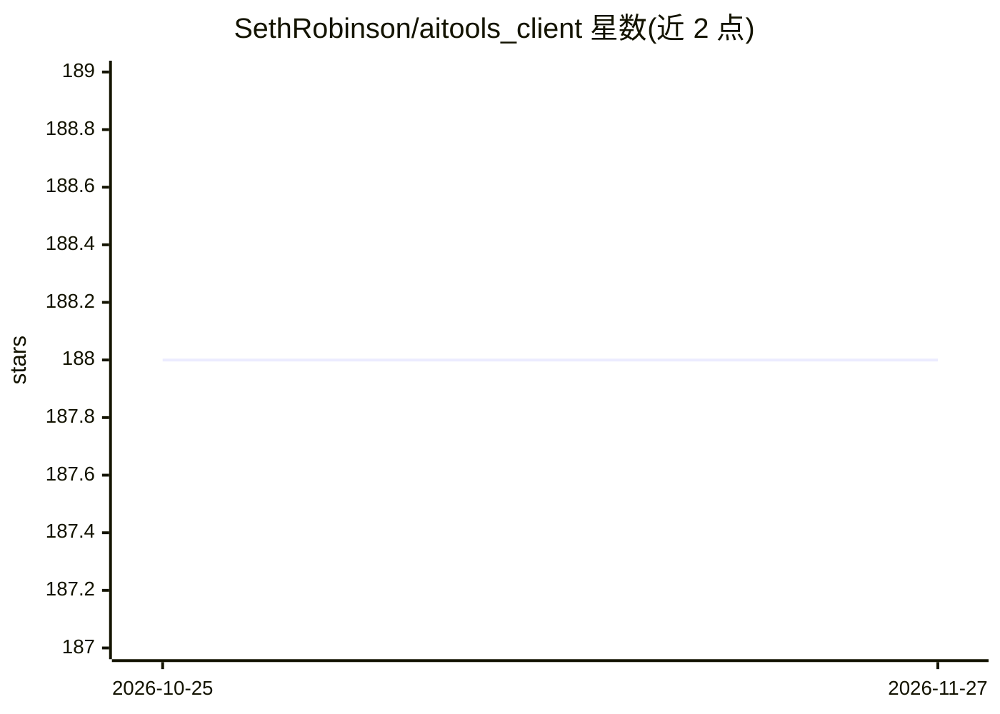

# SethRobinson/aitools_client

⭐ 188 · C# · NOASSERTION · 推送 2026-11-06 · [GitHub](https://github.com/SethRobinson/aitools_client) · 个人维护

**Unity 桌面客户端：用 ComfyUI 与 LLM 生成故事、图像、视频与测验**

以原生 Windows .exe（Unity/C#）运行的 AI 内容创作前端，不依赖 Web 界面。核心是 AI Chat 模式：对话即可生成图像、海报、插图故事与测验，可调用多个 ComfyUI 服务器与多个 LLM 同时工作；联网搜索（Brave Search API）可拉取参考图片/视频片段喂给图像与视频模型，并能读取整页网页做研究。附带的 Python CLI 可在终端直接生图，适用于脚本与 agent 调用。隐私声明为纯本地使用，不上传统计；使用前需自行配置 ComfyUI 服务器并安装其 Workflow 转 API 端点节点。

## 筛选速览

| 维度 | 判定 | 备注 |
|---|---|---|
| AI 角色 | `ai-native` | 本体是模型或模型工具 |
| 许可风险 | `permissive` | NOASSERTION |
| 部署形态 | `desktop` | 安装包/桌面程序 |
| 模型依赖 | local-ok | 支持本地模型 |
| 硬件要求 | — | 无带数字的原话,不猜 |
| 安装摩擦 | `medium` | 含编译或系统依赖之一 |
| 成熟度 | — | 结构信号不足 |

## 能力要点

- AI Chat 模式对话生成图像、海报、插图故事与可导出 HTML 的互动测验
- 可同时接入多个 ComfyUI 服务器与多个 LLM 提供方
- 网页搜索与整页读取，自动拉取参考图片/视频供图像视频模型使用
- 内置 Python CLI，支持 Windows/Linux/macOS 终端生图

## 适用场景

- 通过对话生成插图故事、海报与漫画
- 运行图文结合的实时冒险游戏或自选情节测验
- 终端脚本中批量生成图像
- 参考真实图片/视频素材生成内容

## 场景标签

`图像生成` `AI 写作` · 领域:内容生成

## 证据(README 行号)

> L12: - AI Chat mode is kind of like chatgpt/nanobanana, can just "ask" it to make images, posters, intelligently use anc
> L16: - Built to utilize many ComfyUI servers and LLMs at once
> L18: - Adventure mode allows playing a realtime illustrated adventure (kind of like AI Dungeon) or generate quizes and c

## 星数曲线

2026-10-25 188 → 2026-11-27 188（+0）

---
*卡片 v1 · prompt 1.4 · 生成 2026-11-26 · 置信度 high · 依据 README sha `7f6a32e4f884` · [字段定义](../../DATASET.md)*
