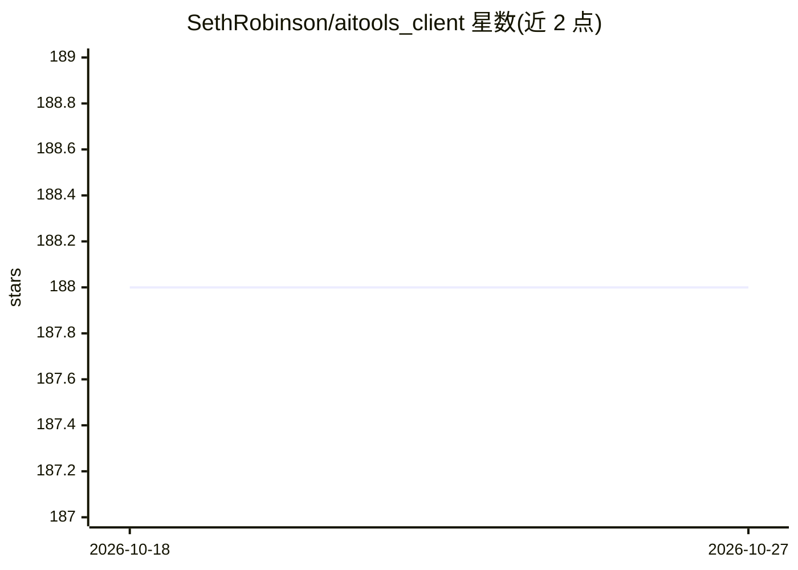

# SethRobinson/aitools_client

⭐ 188 · C# · NOASSERTION · 推送 2026-10-26 · [GitHub](https://github.com/SethRobinson/aitools_client) · 个人维护

**Unity 桌面前端：通过 ComfyUI 与 LLM 生成故事、图像、视频、海报**

本地运行的 Windows 原生 .exe（Unity/C#），面向个人用户的 AI 创作前端：连接多个 ComfyUI 服务器与多家 LLM 服务，提供对话式 AI Chat、图像/视频生成与编辑、插图冒险与测验生成（可导出 HTML）、海报与漫画创作，内置裁剪、遮罩绘制等图像处理。支持联网搜索参考资料（需 Brave Search API key），内置 yt-dlp 与 FFmpeg。依赖外部 ComfyUI 服务器（需 --listen 与配套节点）和各家模型服务的 API key；作者自述为个人实验性工具，功能会随机增删，README 列有已知问题。附 Python CLI 可脚本化生图。macOS/Linux 仅 CLI 支持。

## 筛选速览

| 维度 | 判定 | 备注 |
|---|---|---|
| AI 角色 | `ai-native` | 本体是模型或模型工具 |
| 许可风险 | `permissive` | NOASSERTION |
| 部署形态 | `desktop` | 安装包/桌面程序 |
| 模型依赖 | — | README 未给出锁定关系 |
| 硬件要求 | — | 无带数字的原话,不猜 |
| 安装摩擦 | `medium` | 含编译或系统依赖之一 |
| 成熟度 | `idea` | |

## 能力要点

- 原生 Windows .exe，本地运行，同时调度多个 ComfyUI 服务器与多家 LLM
- AI Chat 对话式生成图像/视频/音频，可联网搜索参考素材并读取网页
- 冒险模式生成实时插图冒险与测验，可导出为独立可玩的 HTML
- 附 Python CLI（Windows/Linux），支持脚本化生成图像

## 适用场景

- 用对话方式生成图像、海报、漫画和短视频
- 创作带插图的故事与可选择分支的互动冒险
- 脚本化批量调用 ComfyUI 预设生成图像

## 场景标签

`图像生成` `视频生成` `AI 写作` · 领域:内容生成

## 证据(README 行号)

> L12: - AI Chat mode is kind of like chatgpt/nanobanana, can just "ask" it to make images, posters, intelligently use anc
> L16: - Built to utilize many ComfyUI servers and LLMs at once
> L148: AI Chat is a feature is kind of "but we have chatgpt image stuff at home" that allows an LLM to basically do every

## 星数曲线

2026-10-18 188 → 2026-10-27 188（+0）

---
*卡片 v1 · prompt 1.4 · 生成 2026-10-22 · 置信度 high · 依据 README sha `3b98077a676c` · [字段定义](../../DATASET.md)*
