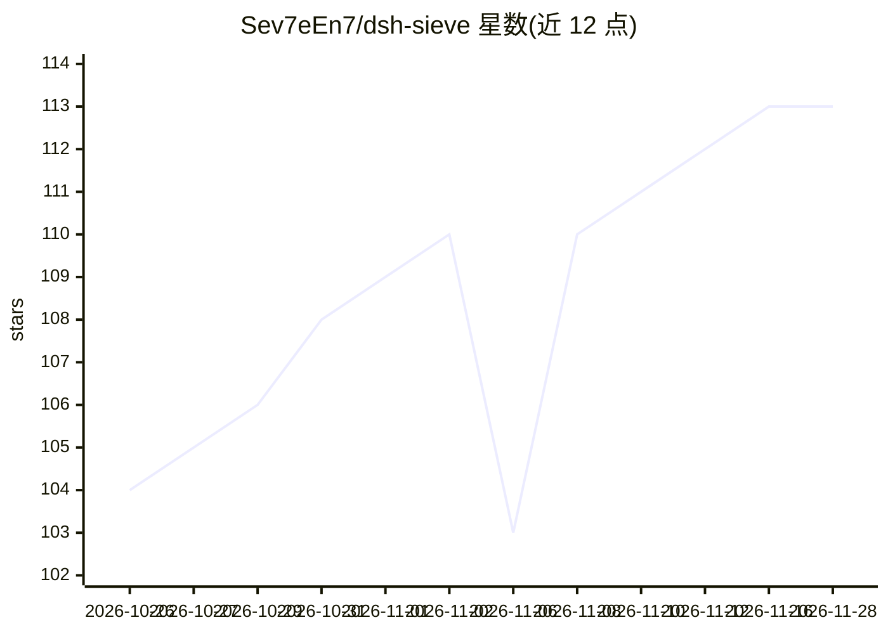

# Sev7eEn7/dsh-sieve

⭐ 113 · TypeScript · MIT · 推送 2026-11-01 · [GitHub](https://github.com/Sev7eEn7/dsh-sieve) · [官网](https://www.npmjs.com/package/dsh-sieve) · 个人维护

**DSH 编码 agent 的上下文与 token 优化插件**

面向 DeepSeek Harness (DSH) 的 TypeScript 插件：在工具结果进入会话前经轻量 judge 模型（~0.3s）判定过滤输出、批量遗忘陈旧上下文、按任务相关性渐进披露技能目录，原始输出先归档可随时读回。附带六个 harness 模块做长任务监督：多 bee 协作 Hive、假完成与死循环监测、检查点回滚、崩溃续跑、调用审批、团队监督。通过 dsh plugin 命令安装，需配置 judge 模型（托管的 Jev 或本地 Laya）。

## 筛选速览

| 维度 | 判定 | 备注 |
|---|---|---|
| AI 角色 | `ai-ecosystem` | LLM/agent 周边工具 |
| 许可风险 | `permissive` | MIT |
| 部署形态 | `library` | 以包/库形式分发 |
| 模型依赖 | — | README 未给出锁定关系 |
| 硬件要求 | — | 无带数字的原话,不猜 |
| 安装摩擦 | `low` | 无编译、无系统依赖或容器化 |
| 成熟度 | — | 结构信号不足 |

## 能力要点

- tool.admission 在结果入会话前过滤，示例中 8,020 字符测试日志压缩至 1,138
- 原始输出先字节级归档到 spill disk，可随时 read 恢复
- 六个 harness 模块：Hive、长任务监测、检查点回滚、崩溃续跑、Jev 审批、团队监督
- conf 低于阈值或出错时安全回退：完整保留原文

## 适用场景

- 编码 agent 长会话中压缩测试日志与工具输出
- 防止 agent 在未跑测试时谎报任务完成或陷入重复报错
- 为崩溃中断的命令判断是否可安全重放

## 场景标签

`编码 Agent` `Agent 记忆` · 领域:Agent 开发

## 证据(README 行号)

> L9: Context engineering, token efficiency and long-task supervision plugins for DeepSeek Harness (DSH)
> L29: sieve is a high-performance DSH plugin that filters tool output, forgets stale context, and discloses skills strict
> L103: > **Released in 0.4.0**; 0.4.1 is the same plugin and also loads on DSH 0.2.1-rc.3 and later. Coming from 0.3.0, w

## 星数曲线

2026-10-26 104 → 2026-11-28 113（+9）

---
*卡片 v1 · prompt 1.4 · 生成 2026-11-28 · 置信度 mid · 依据 README sha `0326cb5c61d9` · [字段定义](../../DATASET.md)*
