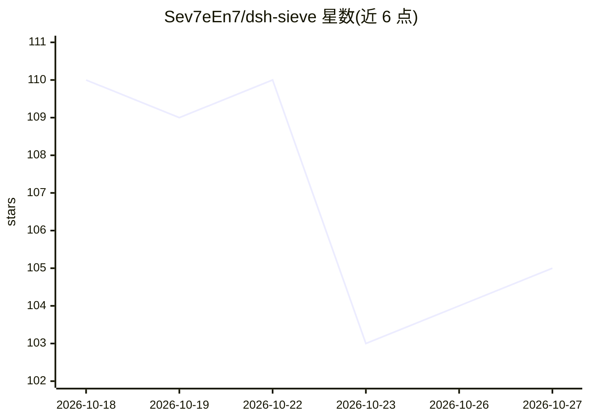

# Sev7eEn7/dsh-sieve

⭐ 105 · TypeScript · MIT · 推送 2026-10-22 · [GitHub](https://github.com/Sev7eEn7/dsh-sieve) · [官网](https://www.npmjs.com/package/dsh-sieve) · 个人维护 · 中文 README

**DeepSeek Harness 的上下文工程与 token 优化插件**

面向 DeepSeek Harness（DSH）AI 编码 agent 的 TypeScript 插件：在 agent 循环内过滤工具输出、批量裁剪过期的历史工具结果、按任务相关性渐进披露技能目录，以减少重复输入 token；原始内容改写前归档、可按需取回。裁剪决策由专门的判断模型（Jev 托管服务或本地 Laya）以结构化问答完成，判断超时或失败一律保留原文。离线回放测得载荷减少 36.28%；历史实测主模型输入 token 降低 21.2%。未配置判断模型时插件不改动任何上下文。

## 筛选速览

| 维度 | 判定 | 备注 |
|---|---|---|
| AI 角色 | `ai-ecosystem` | LLM/agent 周边工具 |
| 许可风险 | `permissive` | MIT |
| 部署形态 | `library` | 以包/库形式分发 |
| 模型依赖 | locked-api |  |
| 硬件要求 | — | 无带数字的原话,不猜 |
| 安装摩擦 | `low` | 无编译、无系统依赖或容器化 |
| 成熟度 | — | 结构信号不足 |

## 能力要点

- 工具输出按类别过滤，保留失败细节与测试摘要
- 旧工具结果批量裁剪并保留归档指针供按需取回
- 渐进式技能披露，按任务相关性注入技能描述
- 判断模型（Jev/Laya）以结构化问答决策，失败或超时保留原文

## 适用场景

- 长会话、多步工具调用的编码 agent 降低输入 token 消耗
- 测试日志冗长的项目中压缩上下文、提高窗口利用率
- 技能目录庞大的 agent 按需披露技能降低无关描述

## 场景标签

 · 领域:AI 编码/agent 基础设施

## 证据(README 行号)

> L7: **LLM agent context engineering and token efficiency plugins for DeepSeek Harness (DSH)**
> L9: sieve filters tool output, prunes older context and progressively discloses skills to reduce redundant input tokens 

## 星数曲线

2026-10-18 110 → 2026-10-27 105（-5）

---
*卡片 v1 · prompt 1.4 · 生成 2026-10-23 · 置信度 mid · 依据 README sha `f9ca09d27502` · [字段定义](../../DATASET.md)*
