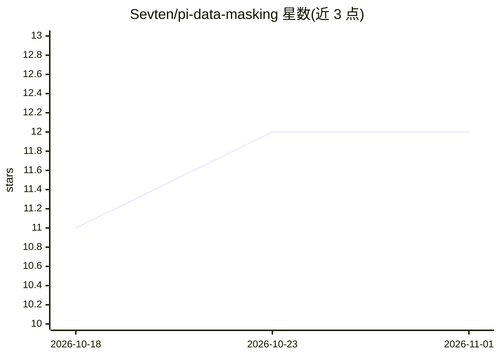

# Sevten/pi-data-masking

⭐ 12 · TypeScript · MIT · 推送 2026-10-24 · [GitHub](https://github.com/Sevten/pi-data-masking) · 个人维护 · 中文 README

**Pi agent 的数据掩码扩展：敏感数据送 LLM 前替换为占位符**

面向 Pi coding agent 的规则驱动数据掩码扩展：在数据到达 LLM 之前，将 API 密钥、令牌、URL、内网主机名等敏感值替换为保持原始形态的占位符（基于 HMAC-SHA-256 会话密钥确定性生成），工具调用仅在规则允许的目标范围内还原真实值，支持 strict/semi-strict/permissive 三档还原模式与发送前审批。提供 /masking 规则管理界面（60+ 内置预设模板）、/masking-history 审计视图，可回放每次还原/阻断决策。局限：基于精确字符串匹配，无法拦截对密钥的探测式采样、哈希或切片操作。

## 筛选速览

| 维度 | 判定 | 备注 |
|---|---|---|
| AI 角色 | `ai-ecosystem` | LLM/agent 周边工具 |
| 许可风险 | `permissive` | MIT |
| 部署形态 | `None` |  |
| 模型依赖 | — | README 未给出锁定关系 |
| 硬件要求 | — | 无带数字的原话,不猜 |
| 安装摩擦 | `low` | 无编译、无系统依赖或容器化 |
| 成熟度 | — | 结构信号不足 |

## 能力要点

- 保持字符类与分隔符形态的自动占位符生成（HMAC-SHA-256 会话密钥，确定性映射）
- 按规则限定真实值可到达的网络目标，三档还原模式与发送前审批
- 60+ 内置预设模板（令牌/凭据/私钥/连接串/IP），GitHub 令牌预设自带作用域
- /masking-history 可按规则版本回放掩码视图与还原审计记录

## 适用场景

- 防止编码 agent 会话中的密钥、凭据泄露给 LLM 提供方
- 限制敏感值只能发送到指定目标（如仅 github.com），阻断提示注入导致的数据外传
- 审计某个真实值被还原到了哪里、某条命令为何被阻断

## 场景标签

`网络安全` · 领域:学习与行业

## 证据(README 行号)

> L5: General-purpose, rule-driven data masking extension for the Pi agent: the model sees placeholders, your tools get th
> L9:  User and tool data is masked before the LLM sees it. A tool call is restored to real values only if its destination

## 星数曲线

2026-10-18 11 → 2026-11-01 12（+1）

---
*卡片 v1 · prompt 1.4 · 生成 2026-11-01 · 置信度 high · 依据 README sha `a1b8ebf31232` · [字段定义](../../DATASET.md)*
