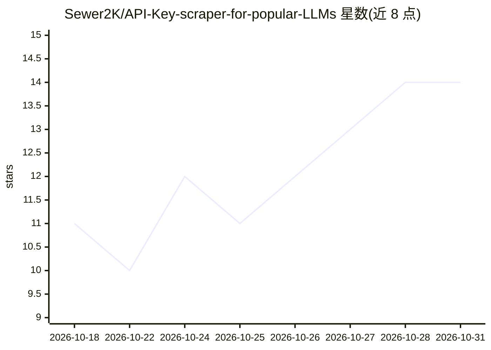

# Sewer2K/API-Key-scraper-for-popular-LLMs

⭐ 14 · Python · GPL-3.0 · 推送 2026-06-24 · [GitHub](https://github.com/Sewer2K/API-Key-scraper-for-popular-LLMs) · 个人维护

**扫描 GitHub 泄露 LLM API key 并验证余额的桌面工具**

基于 PyQt5 的桌面 GUI 应用：通过 GitHub 搜索与 commit diff 下载，用预定义及自定义正则提取 OpenAI、Anthropic、DeepSeek、AWS 等服务的泄露 API key，并发调用各服务 API 端点验证有效性，并支持 DeepSeek 余额查询。提供结果去重、筛选、导出（TXT/CSV/JSON）、自动导出、持久化配置与日志。README 声明仅用于教育与安全研究，且导出文件含未脱敏 key、GitHub token 明文存储。

## 筛选速览

| 维度 | 判定 | 备注 |
|---|---|---|
| AI 角色 | `ai-ecosystem` | LLM/agent 周边工具 |
| 许可风险 | `viral` | GPL-3.0 |
| 部署形态 | `library` | 以包/库形式分发 |
| 模型依赖 | — | README 未给出锁定关系 |
| 硬件要求 | — | 无带数字的原话,不猜 |
| 安装摩擦 | `low` | 无编译、无系统依赖或容器化 |
| 成熟度 | — | 结构信号不足 |

## 能力要点

- 多服务 GitHub commit 搜索与并发 key 提取（可配置线程数）
- 对各服务 API 端点验证 key 有效性，DeepSeek 支持余额查询
- 支持自定义正则模式覆盖预定义列表外的服务
- 结果去重、筛选、导出 TXT/CSV/JSON 与自动导出

## 适用场景

- 检查自有仓库是否意外泄露了 API key
- 安全研究中批量验证泄露凭证的有效性与余额
- 审计导出结果并跟踪泄露来源（commit 元数据）

## 场景标签

`网络安全` `网页抓取` · 领域:效率与自动化

## 证据(README 行号)

> L3: A desktop GUI application that automates the discovery and validation of API keys for AI/LLM services and cloud plat
> L25: - Validation of discovered keys against each service's API endpoints

## 星数曲线

2026-10-18 11 → 2026-10-31 14（+3）

---
*卡片 v1 · prompt 1.4 · 生成 2026-10-31 · 置信度 low · 依据 README sha `2b35f29b48c9` · [字段定义](../../DATASET.md)*
