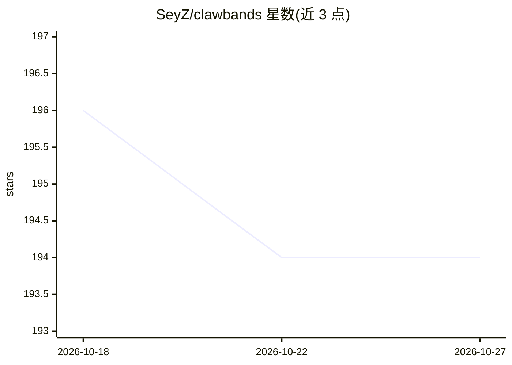

# SeyZ/clawbands

⭐ 194 · TypeScript · MIT · 推送 2026-02-09 · [GitHub](https://github.com/SeyZ/clawbands) · 个人维护

**OpenClaw AI agent 的安全中间件：工具执行前人工审批**

TypeScript/Node.js 编写的 OpenClaw 插件，通过 before_tool_call 钩子拦截全部工具调用（文件读写、Shell 命令、浏览器、网络、网关操作），按 ALLOW/ASK/DENY 三级策略执行：读类放行、写类暂停等待人工审批、删除类自动阻断。审批交互支持终端提示与 WhatsApp/Telegram 渠道（经 clawbands_respond 工具回传），每次决策以 JSON Lines 追加写入不可变审计日志。npm 全局安装，附带 CLI（init/policy/audit/stats）与可编程库接口。

## 筛选速览

| 维度 | 判定 | 备注 |
|---|---|---|
| AI 角色 | `ai-ecosystem` | LLM/agent 周边工具 |
| 许可风险 | `permissive` | MIT |
| 部署形态 | `library` | 以包/库形式分发 |
| 模型依赖 | — | README 未给出锁定关系 |
| 硬件要求 | — | 无带数字的原话,不猜 |
| 安装摩擦 | `low` | 无编译、无系统依赖或容器化 |
| 成熟度 | — | 结构信号不足 |

## 能力要点

- before_tool_call 钩子同步拦截全部工具调用
- ALLOW/ASK/DENY 三级策略，未知动作默认 ASK（fail-secure）
- 终端、WhatsApp、Telegram 渠道的人工审批交互
- JSON Lines 追加式审计日志与统计 CLI

## 适用场景

- 让 OpenClaw agent 执行危险操作前必须经我确认
- 按细粒度策略管控 agent 的文件、Shell 与网络权限
- 审计追溯 agent 每个工具调用的人工决策记录

## 场景标签

 · 领域:AI agent 安全/基础设施

## 证据(README 行号)

> L7: ClawBands is a security middleware for OpenClaw AI agents. It hooks into OpenClaw's plugin system to intercept every
> L17: ClawBands solves this by hooking into OpenClaw's `before_tool_call` plugin event. Before any dangerous action execu

## 星数曲线

2026-10-18 196 → 2026-10-27 194（-2）

---
*卡片 v1 · prompt 1.4 · 生成 2026-10-22 · 置信度 high · 依据 README sha `90bc1ef26aee` · [字段定义](../../DATASET.md)*
