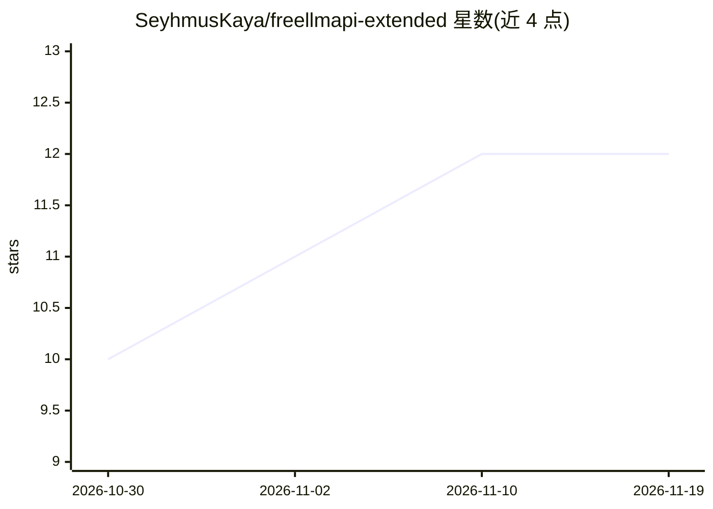

# SeyhmusKaya/freellmapi-extended

⭐ 12 · TypeScript · MIT · 推送 2026-06-03 · [GitHub](https://github.com/SeyhmusKaya/freellmapi-extended) · [官网](https://github.com/SeyhmusKaya/freellmapi-extended/pkgs/container/freellmapi-extended) · 个人维护

**自托管 OpenAI 兼容 LLM 网关：聚合 15+ 免费供应商自动故障转移**

Node.js/TypeScript 编写的自托管 LLM API 网关与聚合器，暴露单一 OpenAI 兼容端点，将聊天、视觉、图像生成、嵌入、音频（STT/TTS）与重排序请求路由到 15+ 供应商的 150+ 免费模型。关键机制：基于实测 7 天成功率与延迟的健康感知重排序、按错误类别区分的自适应冷却、每请求级联故障转移、无密钥供应商兜底、按终端用户消费限额、SQLite 零外部数据库、AES-256-GCM 密钥加密存储，并内置 React 分析仪表盘与 MCP 服务器。面向希望以零代码改动接入多供应商免费推理的开发者。

## 筛选速览

| 维度 | 判定 | 备注 |
|---|---|---|
| AI 角色 | `ai-ecosystem` | LLM/agent 周边工具 |
| 许可风险 | `permissive` | MIT |
| 部署形态 | `self-host` | docker 或自建部署 |
| 模型依赖 | locked-api |  |
| 硬件要求 | — | 无带数字的原话,不猜 |
| 安装摩擦 | `low` | 无编译、无系统依赖或容器化 |
| 成熟度 | — | 结构信号不足 |

## 能力要点

- 单一 OpenAI 兼容端点路由 15+ 供应商 150+ 免费模型，官方 SDK 仅改 base URL
- 基于实测成功率与延迟的健康感知自动路由与每请求级联故障转移
- 支持聊天、视觉、图像生成、嵌入、音频 STT/TTS、重排序 6 种模态与 Batch API
- 内置分析仪表盘、按项目 API 密钥与终端用户消费限额，密钥 AES-256-GCM 加密

## 适用场景

- 为应用统一接入多家免费 LLM 供应商并自动规避限流
- 为 RAG 流水线获取多供应商嵌入与 Cohere 重排序
- 自托管替代方案集中管理 API 密钥与用量成本

## 场景标签

`模型网关` · 领域:Agent 开发

## 证据(README 行号)

> L7: **Self-hosted, open-source LLM gateway & aggregator.** Route chat, vision, image generation, embeddings, audio (STT/
> L30: **FreeLLMAPI-Extended is a free, self-hosted LLM API gateway.** It exposes a single OpenAI-compatible REST endpoint
> L42: |🔁 **Automatic fallback cascade**|Per-request failover across models and providers, with adaptive cooldowns (minute

## 星数曲线

2026-10-30 10 → 2026-11-19 12（+2）

---
*卡片 v1 · prompt 1.4 · 生成 2026-11-18 · 置信度 high · 依据 README sha `68a418296bd5` · [字段定义](../../DATASET.md)*
