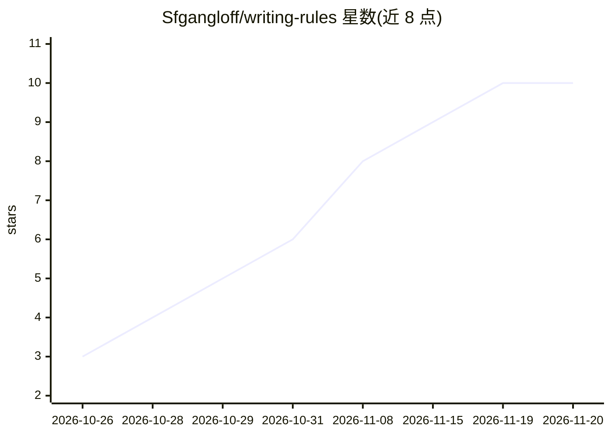

# Sfgangloff/writing-rules

⭐ 10 · Python · CC-BY-4.0 · 推送 2026-11-09 · [GitHub](https://github.com/Sfgangloff/writing-rules) · 个人维护

**供 Claude Code 使用的学术写作规则集与插件**

将从约一年、约 1,000 次论文修改记录中提炼的学术写作纠正规则，打包为 Claude Code 插件 writing-toolkit。包含三个部分：起草/编辑/审阅时自动加载的 academic-writing 技能（核心规则+按需打开的分类细则）、五阶段整稿审阅流程 review-pass（逐段模拟读者提问、全局检查、篇幅、附录、交接），以及扫描 .tex 新写入文本中 AI 腔短语并要求改写的 linter（需 python3）。维护者声明当前仅为第一版，规则源自单一研究者，通过两命令贡献流程匿名征集多人纠正并合并。

## 筛选速览

| 维度 | 判定 | 备注 |
|---|---|---|
| AI 角色 | `ai-knowledge` | 知识聚合/清单类 |
| 许可风险 | `viral` | CC-BY-4.0 |
| 部署形态 | `None` |  |
| 模型依赖 | — | README 未给出锁定关系 |
| 硬件要求 | — | 无带数字的原话,不猜 |
| 安装摩擦 | `low` | 无编译、无系统依赖或容器化 |
| 成熟度 | `idea` | |

## 能力要点

- academic-writing 技能：核心规则+按任务分类加载的细则文件
- review-pass 五阶段审阅流程，含模拟读者逐段提问
- linter 用正则扫描 .tex/.md 中的 AI 腔短语并建议改写
- 两命令贡献流程：从 Claude Code 历史提取纠正，匿名提交 PR

## 适用场景

- 让 Claude 起草或修改论文时不再重复犯同样的写作问题
- 投稿前对草稿做一轮模拟读者式的整稿审阅
- 把个人写作纠正历史贡献为社区共享规则

## 场景标签

`AI 写作` `提示工程` · 领域:Agent 开发

## 证据(README 行号)

> L5:  Academic writing rules for Claude, distilled from real paper-editing sessions.
> L27: - **The `academic-writing` skill.** Claude loads it whenever it drafts, edits or reviews an academic text. It holds

## 星数曲线

2026-10-26 3 → 2026-11-20 10（+7）

---
*卡片 v1 · prompt 1.4 · 生成 2026-11-20 · 置信度 high · 依据 README sha `ef19a22d271d` · [字段定义](../../DATASET.md)*
