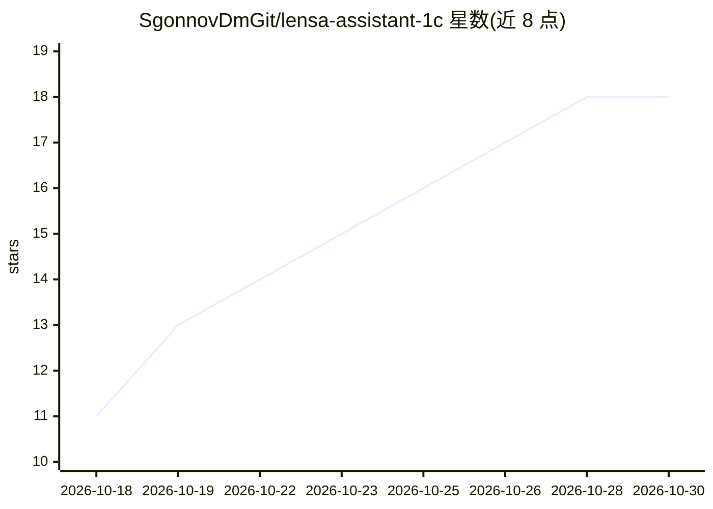

# SgonnovDmGit/lensa-assistant-1c

⭐ 18 · NOASSERTION · 推送 2026-10-26 · [GitHub](https://github.com/SgonnovDmGit/lensa-assistant-1c) · [官网](https://digitalmechanics.dev/?utm_source=github_assistant&utm_medium=repo&utm_campaign=gh-assistant-about) · 个人维护

**1С 数据库内的 AI 助手：按您的数据回答并填写/创建文档**

面向 1С:Предприятие 8.3/8.5 的外部处理（.epf）文件：AI 助手读取数据库配置元数据与文档内容后回答问题，经用户许可可填写、过账、创建文档。提供两种模式：«Контроль» 下每步动作展示代码并请求确认，«Доверие» 下自动执行并留痕。模型连接经 «Линза» 服务（Claude/GPT/Gemini/DeepSeek 等可选），处理文件免费下载，服务能力需另行在 digitalmechanics.dev 开通；代码可读可改但非 open source。

## 筛选速览

| 维度 | 判定 | 备注 |
|---|---|---|
| AI 角色 | `ai-native` | 本体是模型或模型工具 |
| 许可风险 | `none` | NOASSERTION |
| 部署形态 | `None` |  |
| 模型依赖 | — | README 未给出锁定关系 |
| 硬件要求 | — | 无带数字的原话,不猜 |
| 安装摩擦 | `low` | 无编译、无系统依赖或容器化 |
| 成熟度 | — | 结构信号不足 |

## 能力要点

- 读取数据库元数据与文档后作答，步骤在信息流中可见
- 两种执行模式：逐步确认或自动执行留痕
- 生成 .erf/.epf 报表与处理文件，回答中带可点击的文档链接
- 后台异步回复，支持互联网与平台语法帮助查询

## 适用场景

- 用自然语言查询 1С 数据库中的单据与目录
- 让助手查找并填写单据缺失的必填字段后过账
- 批量查找并登记季度发票
- 按对话生成 1С 报表与外部处理文件

## 场景标签

`AI 助手` · 领域:对话与助手

## 证据(README 行号)

> L12: Внешняя обработка для 1С:Предприятие: ИИ-ассистент, который работает в вашей базе.
> L58: - **Нейросеть под задачу.** Claude, GPT, Gemini, DeepSeek и другие - выбор в строке ввода.

## 星数曲线

2026-10-18 11 → 2026-10-30 18（+7）

---
*卡片 v1 · prompt 1.4 · 生成 2026-10-29 · 置信度 high · 依据 README sha `0d03f34fb28b` · [字段定义](../../DATASET.md)*
