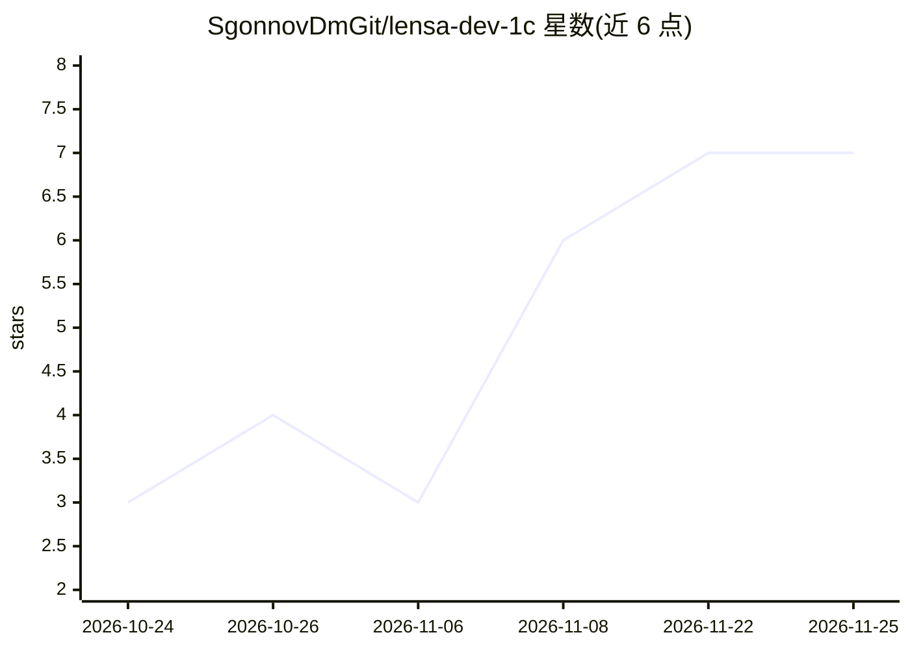

# SgonnovDmGit/lensa-dev-1c

⭐ 7 · NOASSERTION · 推送 2026-11-20 · [GitHub](https://github.com/SgonnovDmGit/lensa-dev-1c) · [官网](https://lensacode.ai/developer?utm_source=github_developer&utm_medium=repo&utm_campaign=gh-developer-about) · 个人维护

**给 1C 开发者的 AI 代理：在配置器内读写模块代码并验证**

运行于 Windows 的桌面程序，作为 1C:Конфигуратор 内的 AI 代理：可打开的模块中按过程/区域读取与定点修改代码并以标记显示改动，运行平台自带的模块检查、读取消息面板并修正报错，查找配置对象（如目录属性）并打开其模块。附带独立代码编辑沙盒（1C 语法高亮、支持从磁盘/EDT 导入）、AI 规划的任务看板及每次调用的用量计量。需通过 «Линза» 服务密钥联网接入神经网络；无配置器时沙盒仍可用。

## 筛选速览

| 维度 | 判定 | 备注 |
|---|---|---|
| AI 角色 | `ai-native` | 本体是模型或模型工具 |
| 许可风险 | `none` | NOASSERTION |
| 部署形态 | `desktop` | 安装包/桌面程序 |
| 模型依赖 | — | README 未给出锁定关系 |
| 硬件要求 | — | 无带数字的原话,不猜 |
| 安装摩擦 | `low` | 无编译、无系统依赖或容器化 |
| 成熟度 | — | 结构信号不足 |

## 能力要点

- 在打开的 1C 模块中按过程/区域读取并定点修改代码，改动有标记
- 运行平台 штат 检查并读取消息面板，仅在平台确认后报告成功
- 无需配置器即可使用的代码编辑沙盒（1C 高亮、区域折叠、EDT 导入）
- AI 任务看板与每次调用的神经网络用量计量

## 适用场景

- 让 AI 在配置器里读取和修改 1C 模块代码
- 让 AI 运行平台检查并自动修复模块报错
- 在无配置器环境下编辑 1C 代码再一键回传配置器

## 场景标签

`AI 助手` `编码 Agent` · 领域:编码与开发

## 证据(README 行号)

> L7: **Вайбкодинг в 1С**: ИИ-агент работает внутри конфигуратора — видит окна, читает модули, правит код
> L16: - **Читает и правит код в открытом модуле.** Большой модуль на тысячи строк нейросеть читает по
> L47: |1С|Конфигуратор 1С:Предприятие 8.3 или 8.5 — для работы с конфигурацией; песочница работает и без него|

## 星数曲线

2026-10-24 3 → 2026-11-25 7（+4）

---
*卡片 v1 · prompt 1.4 · 生成 2026-11-20 · 置信度 high · 依据 README sha `2523a2f9c0d4` · [字段定义](../../DATASET.md)*
