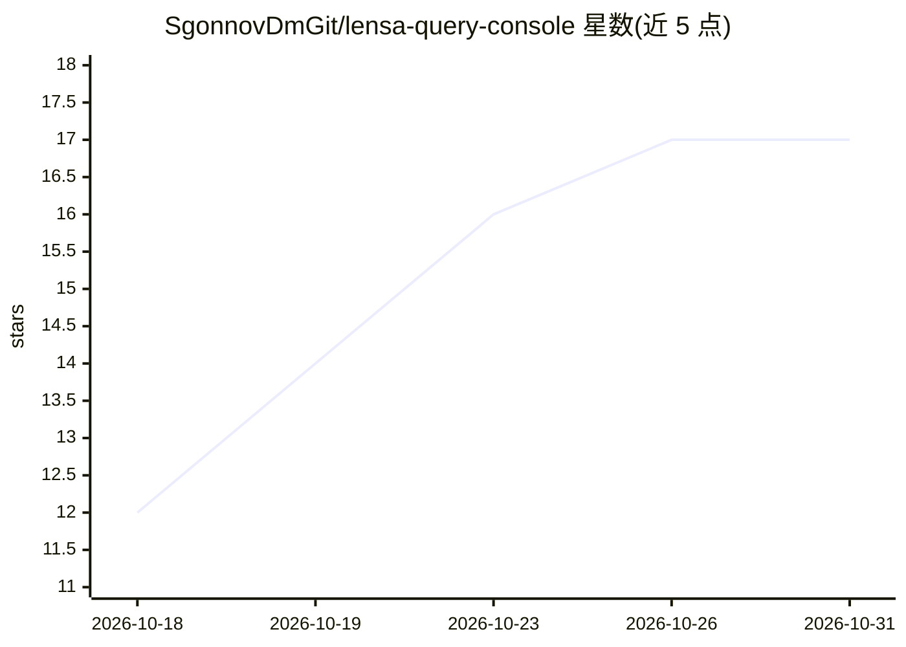

# SgonnovDmGit/lensa-query-console

⭐ 17 · NOASSERTION · 推送 2026-10-25 · [GitHub](https://github.com/SgonnovDmGit/lensa-query-console) · 个人维护

**面向 1С 用户的查询控制台，AI 助手按元数据组装查询**

1С:Предприятие 的外部处理文件（.epf）：提供查询控制台（执行查询、原生查询构造器、参数与自动保存、.q1cs/.q1c 文件），其中 AI 部分为读取配置元数据（对象类型、寄存器结构、属性）后按自然语言任务组装查询的 agent，查询文本执行前可见，agent 不读取结果数据行。生成的查询可一步导出为外部报表 .erf 或外部处理 .epf。要求平台 8.3.16+、管理表单、БСП；控制台本体离线可用，AI 功能需注册获取密钥并消耗代币（起始 500）。产品免费但非 open source，权利归权利人。

## 筛选速览

| 维度 | 判定 | 备注 |
|---|---|---|
| AI 角色 | `ai-enhanced` | 去掉 AI 部分产品仍成立 |
| 许可风险 | `none` | NOASSERTION |
| 部署形态 | `None` |  |
| 模型依赖 | — | README 未给出锁定关系 |
| 硬件要求 | — | 无带数字的原话,不猜 |
| 安装摩擦 | `low` | 无编译、无系统依赖或容器化 |
| 成熟度 | — | 结构信号不足 |

## 能力要点

- AI agent 先读取配置元数据再组装查询，步骤在“进程”面板可见（含上下文与成本）
- 查询文本执行前可见，agent 不读取结果数据行
- 从现成查询一步生成外部报表 .erf 或外部处理 .epf，按 БСП 标准机制连接
- 控制台本体（查询执行、构造器）无需密钥，离线可用

## 适用场景

- 用自然语言描述任务，让 AI 在我的 1С 配置上组装查询
- 执行和编辑 1С 查询、管理查询列表与参数
- 把写好的查询转成可标准连接的外部报表或处理

## 场景标签

`数据分析` · 领域:效率与自动化

## 证据(README 行号)

> L12: Внешняя обработка для 1С:Предприятие: консоль запросов, в которой ИИ-помощник читает
> L81: |Доступ в сеть|Нужен только для ИИ-помощника. Консоль без ИИ работает офлайн|
> L107: Выполнение запросов и конструктор работают без всякого ключа - скачал и работай.

## 星数曲线

2026-10-18 12 → 2026-10-31 17（+5）

---
*卡片 v1 · prompt 1.4 · 生成 2026-10-29 · 置信度 high · 依据 README sha `3054feaf96ba` · [字段定义](../../DATASET.md)*
