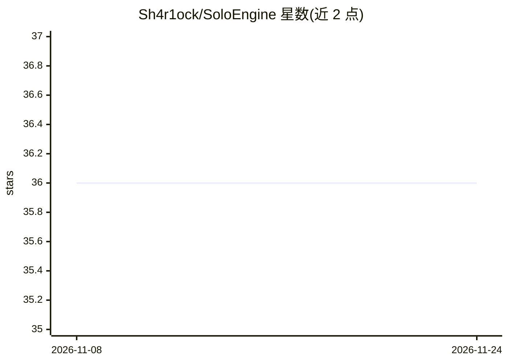

# Sh4r1ock/SoloEngine

⭐ 36 · TypeScript · Apache-2.0 · 推送 2026-11-20 · [GitHub](https://github.com/Sh4r1ock/SoloEngine) · 个人维护 · 中文 README

**低代码可视化构建 Agent 团队的开源平台（拖拽式 Harness）**

面向不会写代码的领域专家与开发者的低代码 Agentic AI 平台：在可视化画布上拖拽 Agent、连线配置协作者，画布经拓扑排序编译为 Agent DAG，每个 Agent 以统一 ReAct 引擎（Think→Act→Observe 循环）自主运行直至任务完成。提供模型适配器支持 OpenAI/Anthropic/Ollama/DeepSeek/Qwen 等，工具与 MCP 热插拔并按需加载，可一键打包为产品。以 Python/FastAPI/React 技术栈实现，通过 git clone 源码启动，Apache 2.0 许可。

## 筛选速览

| 维度 | 判定 | 备注 |
|---|---|---|
| AI 角色 | `ai-ecosystem` | LLM/agent 周边工具 |
| 许可风险 | `permissive` | Apache-2.0 |
| 部署形态 | `None` |  |
| 模型依赖 | local-ok | 支持本地模型 |
| 硬件要求 | — | 无带数字的原话,不猜 |
| 安装摩擦 | `low` | 无编译、无系统依赖或容器化 |
| 成熟度 | — | 结构信号不足 |

## 能力要点

- 可视化画布经拓扑排序编译为 Agent DAG，无需编排代码
- 所有 Agent 共用同一 ReAct 引擎，运行时动态决策
- 统一模型适配器：OpenAI/Anthropic/Ollama/DeepSeek/Qwen/智谱
- 工具、技能、MCP 热插拔与按需加载的渐进式披露设计

## 适用场景

- 律师拖拽搜索、归档、格式化 Agent 组队自动完成法律工作拆解
- 营销人员组合调研、文案、素材 Agent 生成营销方案
- 不会编程的领域专家独立搭建多 Agent 协作系统

## 场景标签

`多智能体` `工作流自动化` `Agent 框架` · 领域:Agent 开发

## 证据(README 行号)

> L5:  SoloEngine is the first open-source low-code platform purpose-built for crafting Harness. Drag an Agent onto the ca
> L45: 1. **Compilation** — Visual layout → Agent DAG via topological sort. One compiler, infinite teams.

## 星数曲线

2026-11-08 36 → 2026-11-24 36（+0）

---
*卡片 v1 · prompt 1.4 · 生成 2026-11-18 · 置信度 high · 依据 README sha `c69c2b9355b9` · [字段定义](../../DATASET.md)*
