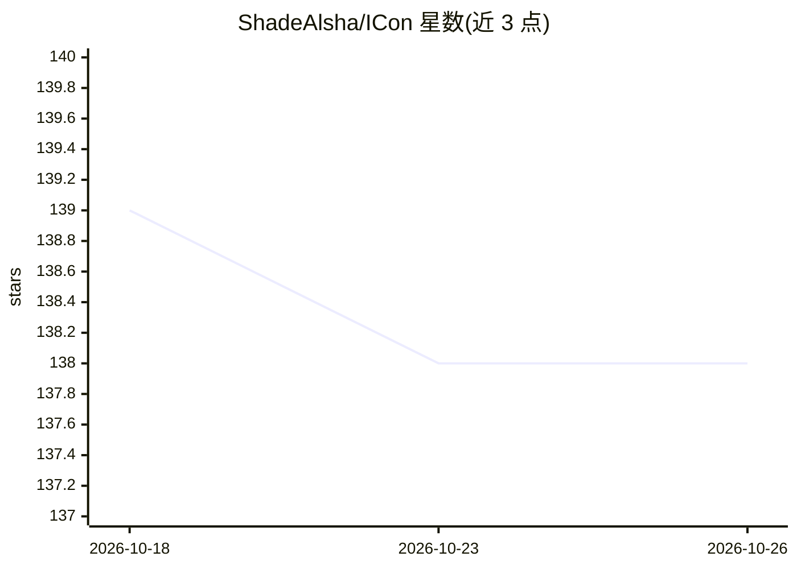

# ShadeAlsha/ICon

⭐ 138 · Jupyter Notebook · 推送 2026-02-18 · [GitHub](https://github.com/ShadeAlsha/ICon) · [官网](https://aka.ms/i-con) · 组织维护

**统一表示学习框架：一个方程覆盖 20+ 种 ML 方法**

ICLR 2025 论文 "I-Con: A Unifying Framework for Representation Learning" 的官方实现。提供一个以 Config（mapper + supervisory_distribution + learned_distribution）为核心的 Python 框架，将 SimCLR、t-SNE、监督对比学习、交叉熵等 20 余种表示学习/机器学习方法统一到单一方程下，支持几行代码快速原型化新算法。内置 CNN/ResNet/MLP 等结构与多种核和图方法组件，配套 TensorBoard 可视化套件与 playground CLI；设备支持 CPU/CUDA/Apple Silicon MPS 自动选择。面向机器学习研究者与开发者，通过 git clone 源码安装。

## 筛选速览

| 维度 | 判定 | 备注 |
|---|---|---|
| AI 角色 | `ai-ecosystem` | LLM/agent 周边工具 |
| 许可风险 | `none` | — |
| 部署形态 | `library` | 以包/库形式分发 |
| 模型依赖 | — | README 未给出锁定关系 |
| 硬件要求 | — | 无带数字的原话,不猜 |
| 安装摩擦 | `medium` | 含编译或系统依赖之一 |
| 成熟度 | — | 结构信号不足 |

## 能力要点

- 单一 Config 模式统一 20+ 种机器学习方法
- 内置距离核、图方法、聚类组件与 CNN/ResNet/MLP 结构，均可扩展
- TensorBoard 集成的嵌入与邻域分布可视化套件
- playground CLI 支持 CUDA/MPS/CPU 设备自动选择

## 适用场景

- 用几行代码复现 SimCLR、参数化 t-SNE 等方法
- 通过替换组件快速原型化新的表示学习算法
- 在论文实验中统一对比多种方法的实现

## 场景标签

`模型训练` · 领域:训练与推理

## 证据(README 行号)

> L13: > **TL;DR**: We introduce a single equation that unifies >20 machine learning methods into a periodic table. Our fr
> L27: Every representation learning method answers three questions:
> L104: |Separate implementations for each method|Universal config pattern|

## 星数曲线

2026-10-18 139 → 2026-10-26 138（-1）

---
*卡片 v1 · prompt 1.4 · 生成 2026-10-22 · 置信度 mid · 依据 README sha `0e8bc2dbf27f` · [字段定义](../../DATASET.md)*
