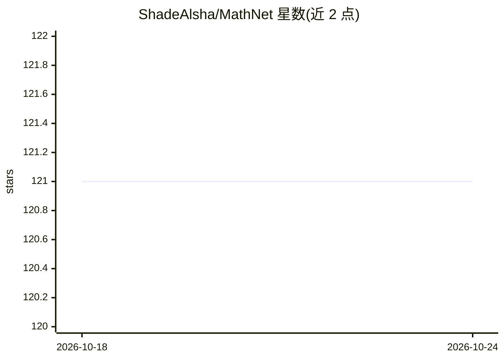

# ShadeAlsha/MathNet

⭐ 121 · 推送 2026-04-21 · [GitHub](https://github.com/ShadeAlsha/MathNet) · [官网](https://mathnet.mit.edu) · 组织维护

**面向研究者的多语种奥数推理与检索基准数据集（30,676 题）**

ICLR 2026 论文的官方实现：MathNet 是从 47 国 1985–2025 年官方竞赛手册（1,595 份 PDF、逾 2.5 万页）经多阶段 LLM 管线抽取的 30,676 道带专家解答的奥数级数学题，覆盖 17 种语言。配套三项评测任务：生成式问题求解、数学感知检索、检索增强求解。数据经 Hugging Face datasets 库加载，含层级主题标签与溯源字段。作者来自 MIT、KAUST、HUMAIN 等。注意事项：非污染清洁、预览版 schema 可能变更、LLM 辅助元数据未完全人工审计。

## 筛选速览

| 维度 | 判定 | 备注 |
|---|---|---|
| AI 角色 | `ai-knowledge` | 知识聚合/清单类 |
| 许可风险 | `none` | — |
| 部署形态 | `None` |  |
| 模型依赖 | — | README 未给出锁定关系 |
| 硬件要求 | — | 无带数字的原话,不猜 |
| 安装摩擦 | `low` | 无编译、无系统依赖或容器化 |
| 成熟度 | `idea` | |

## 能力要点

- 30,676 道专家撰写带解答的奥数题，覆盖 47 国、17 语言、1985–2025
- 三项基准任务：问题求解、数学感知检索、检索增强求解
- 多阶段 LLM 抽取管线（dots-ocr + GPT-4.1 三重校验 + 人工复核）
- 每题保留来源手册、页码、作者等溯源信息

## 适用场景

- 评测大模型或多模态模型的奥数级推理能力
- 评测 embedding 模型的数学等价/结构相似检索能力
- 用作可验证答案问题的 RL 训练数据

## 场景标签

`模型评测` `强化学习` · 领域:评测与运维

## 证据(README 行号)

> L34: Mathematical problem solving remains a challenging test of reasoning for large language and multimodal models, yet 
> L36: MathNet spans **47 countries**, **17 languages**, and **two decades** of competitions, comprising **30,676 expert-a

## 星数曲线

2026-10-18 121 → 2026-10-24 121（+0）

---
*卡片 v1 · prompt 1.4 · 生成 2026-10-23 · 置信度 high · 依据 README sha `2507ce46378a` · [字段定义](../../DATASET.md)*
