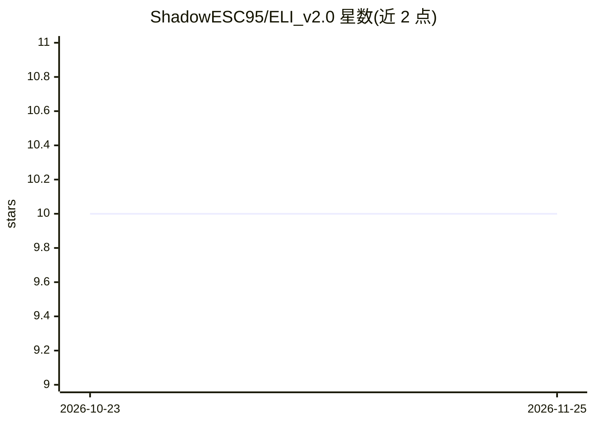

# ShadowESC95/ELI_v2.0

⭐ 10 · Python · Apache-2.0 · 推送 2026-11-23 · [GitHub](https://github.com/ShadowESC95/ELI_v2.0) · [官网](https://geteli.tech) · 个人维护

**完全本地运行的 AI 桌面助手：语音/视觉/记忆，离线默认**

ELI 是一个在用户自己硬件上完整运行的 AI 助手与'认知运行时'：12 阶段推理管线、DAG 编排的多 agent、分层记忆（SQLite + FAISS 向量索引 + 知识图谱），提供 231 项能力，覆盖桌面控制、媒体、屏幕/文档理解、代码、任务自动化与语音。用户自带 GGUF 模型，推理经 llama.cpp，支持 CUDA/Vulkan/Metal 加速与 CPU 回退。隐私机制上通过 netguard 在 socket 层强制离线（fail-closed），可选联网功能需显式开启。提供 Windows/macOS/Linux 安装包，Linux 需 glibc 2.39+；LoRA 自微调依赖 PyTorch/PEFT。

## 筛选速览

| 维度 | 判定 | 备注 |
|---|---|---|
| AI 角色 | `ai-native` | 本体是模型或模型工具 |
| 许可风险 | `none` | Apache-2.0 |
| 部署形态 | `desktop` | 安装包/桌面程序 |
| 模型依赖 | local-ok | 支持本地模型 |
| 硬件要求 | `cpu-ok` | |
| 安装摩擦 | `medium` | 含编译或系统依赖之一 |
| 成熟度 | — | 结构信号不足 |

## 能力要点

- 231 项能力，覆盖桌面控制、视觉、语音、记忆与自动化
- socket 层 fail-closed 网络守卫，离线为默认且强制执行
- 模型无关：加载任意本地 GGUF，自动检测 chat template 并按 VRAM 推荐模型
- 自维护：失败分析、自补丁（可回滚）与 LoRA/QLoRA 自微调管线

## 适用场景

- 在无网络或不愿数据出本机的环境里使用 AI 助手
- 语音/文字控制桌面应用、媒体播放与系统设置
- 本地总结 PDF/CSV、读屏、图像描述与文档生成
- 用自己的对话历史对本地模型做 LoRA 微调

## 场景标签

`AI 助手` `语音 Agent` `多智能体` `微调` · 领域:Agent 开发

## 证据(README 行号)

> L15: ELI is an AI assistant that runs **entirely on your own machine** — and I mean *entirely* for
> L40: layered memory (SQLite + a FAISS vector index + a knowledge graph), local voice and vision, and its
> L132: 2. **Model-agnostic.** No model name or size is hardcoded on the inference path. ELI loads any

## 星数曲线

2026-10-23 10 → 2026-11-25 10（+0）

---
*卡片 v1 · prompt 1.4 · 生成 2026-11-20 · 置信度 mid · 依据 README sha `a66b64ff01c2` · [字段定义](../../DATASET.md)*
